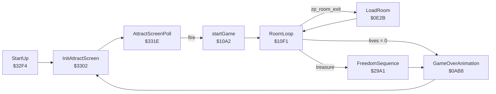

# Monty on the Run – Architecture

How the game image (`$080E–$FF72`) is organised at run time: start-up, memory, banking, interrupts, the frame, the room
pipeline and the subsystems. Addresses are those of the original image; labels are those in `byte-perfect/src/motr.asm`.
The refactored build moves code, so its addresses differ, but its names map across (`MainGameLoop` is `GameFrameUpdate`,
`MusicPlay` is `Music.Play`); see [SOURCE_GUIDE.md](SOURCE_GUIDE.md).

---

## Overview

The game is one 63,333-byte image loaded at `$080E`. It has no BASIC line; it is started with `SYS 2064`, which runs the
`JMP StartUp` at `$0810`. It banks out BASIC and the KERNAL, owns the IRQ and NMI vectors at `$FFFA–$FFFF`, and draws in
VIC bank 1 (`$4000–$7FFF`). One self-rescheduling raster interrupt drives everything: almost all of the game runs inside
it.

| Layer       | Range         | Contents                                                          |
| :---------- | :------------ | :---------------------------------------------------------------- |
| Code        | `$080E–$3FF5` | Engine, front end, hi-scores, scroller (a dead loader at the end) |
| VIC bank 1  | `$4000–$7FFF` | Charset, screen, sprites, hi-score table, anti-hack screen        |
| Sound       | `$8000–$95FF` | CBM80 header, Rob Hubbard's driver, effects, music data           |
| Level data  | `$9600–$CFFF` | Room maps, tiles, enemies, room records, Freedom Kit icons        |
| (I/O)       | `$D000–$DFFF` | Zeros in the image; the RAM there is never used                   |
| Decorations | `$E000–$FF72` | 97 decoration bitmaps, sizes and the per-room placement list      |

---

## Start-Up

| Address | Label               | Role                                                                        |
| :------ | :------------------ | :-------------------------------------------------------------------------- |
| `$0810` | –                   | `JMP StartUp`, the `SYS 2064` entry                                         |
| `$32F4` | `StartUp`           | `SEI`, install the IRQ/NMI vectors (`InitializeInterrupts`), zero the score |
| `$3302` | `InitAttractScreen` | Reset the stack, clear zero page, music, VIC set-up, carousel, hi-scores    |
| `$331E` | `AttractScreenPoll` | Title loop: keys, hi-score display timer, fire starts a game                |
| `$10A2` | `startGame`         | New game: clear zero page, HUD, five lives, start position, room `$00`      |
| `$10F1` | `RoomLoop`          | Foreground loop: death/event dispatch, then room changes                    |
| `$0AB8` | `GameOverAnimation` | GAME OVER sprites, then back to `InitAttractScreen`                         |

`InitializeInterrupts` (`$0D16`) points the vectors at `IrqHandler` (`$0D54`) and `NmiHandler` (`$0D8A`), stops CIA1
timer A, enables the raster interrupt at line 0, sets the processor port to `$05` and executes `CLI`.

### The Start-Up Race

That `CLI` comes 2,336 cycles before `InitAttractScreen` sets `zp_attract_mode` (measured in VICE). A raster interrupt
in that window takes the game path with an uninitialised zero page. The character animation then stores through the
still-empty pointer table at `$02E6`, writes to `$0000` (the processor port's direction register), banks the ROMs in and
jams the CPU. The window is 11.9% of a PAL frame, so from a random start position about one launch in eight fails. The
KERNAL's idle loop happens to put `SYS 2064` on raster line 300, 644 cycles before line 0, so a launcher that starts
there fails every time. `tools/launch.py` starts on a safe line instead (`just race` shows the failure). The refactored
build fixes it by unmasking interrupts only after `zp_attract_mode` is set.

`startGame` has the same exposure, because it clears zero page with interrupts on. It is safe in practice: fire is read
inside the attract interrupt, so `startGame` always begins about 150 raster lines before the next one.

---

## Memory

### Banking

`InitializeInterrupts` writes `$05` to the processor port (`$01`): LORAM=1, HIRAM=0, CHAREN=1. BASIC and the KERNAL are
both hidden, I/O stays at `$D000`, and `$A000–$BFFF` and `$E000–$FFFF` are RAM. The decorations at `$E000` are therefore
game data. `InitialiseGraphicsMode` selects VIC bank 1 (`$DD00` bits 0–1 = `%10`) and writes `$20` to `$D018`, giving
screen RAM at `$4800` and the character set at `$4000`. `$D016` keeps multicolour off: the playfield is hires text, one
colour per cell on a black background.

### Region Map

| Range         | Contents                                                                          |
| :------------ | :-------------------------------------------------------------------------------- |
| `$0002–$0005` | Music track and pattern pointers                                                  |
| `$0006–$00F2` | Game state (see below)                                                            |
| `$0200–$021F` | `enemy_state_tbl`: 4 enemy slots × 8 bytes                                        |
| `$0228–$022B` | `enemy_xmsb_tbl`: sprite X bit 8 for the enemies                                  |
| `$022C–$028B` | Enemy sprite unpacking buffers (32 in, 64 out)                                    |
| `$0290–$0293` | `enemy_anim_timer_tbl`                                                            |
| `$0294–$0298` | Score: five ASCII digits, copied straight to the screen                           |
| `$02A0`       | `lives_count`                                                                     |
| `$02A6–$02E5` | `room_entity_collected_tbl`: one flag per coin (64)                               |
| `$02E6–$0307` | `room_entity_buf`: colour-RAM pointers of the coins in this room                  |
| `$0308–$031C` | `si_collected_tbl`: special items collected (`$81`)                               |
| `$031D–$0321` | `fk_room_item_active`: the five checked Freedom Kit items                         |
| `$0327–$0426` | `decor_init_flags` (256 bytes, overlapping the start of the buffer below)         |
| `$0400–$067F` | Scratch: `DrawRoomPlayfield` decodes a room's tile map here; hi-score work buffer |
| `$080E–$080F` | `cheatmode`, `sound_mode`                                                         |
| `$0810–$3FF5` | Code and its tables                                                               |
| `$3E23–$3FF5` | Dead: a tape-loader stub that sets up the VIC bank and ends `JMP $0810`           |
| `$4000–$47FF` | Character set: font `$40–$7F`, room tiles 1–8, decoration chars `$9B–$FE`         |
| `$4800–$4BE7` | Screen RAM (its initial contents are build leftovers)                             |
| `$4BF8–$4BFF` | Sprite pointers                                                                   |
| `$4C00–$53FF` | Enemy sprite frames, unpacked per room: 4 slots × 8 frames                        |
| `$5400–$70FF` | Monty, lift, jetpack, piledriver, special item, C5, boat, flag, GAME OVER sprites |
| `$6700–$677F` | Dissolve buffers (sprite frames `$9C`, `$9D`)                                     |
| `$7100–$71C9` | `AntiHackScreen`                                                                  |
| `$7300–$772B` | Hi-score table: 50 scores, 50 names, name input buffer                            |
| `$7800–$7AFF` | Enemy types 32–34 (the GOOD LUCK banner and MPL logo), packed                     |
| `$8000–$8011` | CBM80 cartridge header (protection)                                               |
| `$8012–$8565` | Music driver, effect engine, frequency table, driver variables                    |
| `$8566–$9553` | Song pointers, patterns, instruments, `sfx_tbl`                                   |
| `$9554–$959F` | Music API: `MusicInit`, `MusicStop`, `ClearSFXTrigger`, `MusicPlaySFX`            |
| `$95A0–$95F9` | Dead: a KERNAL-interrupt music test harness (see [SOUND.md](SOUND.md))            |
| `$9600–$970F` | Level-data pointers (see [DATA_FORMATS.md](DATA_FORMATS.md))                      |
| `$9710–$AD3A` | 52 run-length-coded room tile maps                                                |
| `$AD3B–$B102` | Tile library: 121 tiles                                                           |
| `$B103–$C202` | 24 enemy sprite banks, packed                                                     |
| `$C203–$C6B9` | Enemy start records per room                                                      |
| `$C6BA–$C9F9` | Room records: 52 × 16 bytes (tiles, colours)                                      |
| `$C9FA–$CC71` | Attract-screen character graphics (copied into `$4000` on the title)              |
| `$CC72–$CF31` | Freedom Kit icons: 22 × 32 bytes                                                  |
| `$CF32–$CFFF` | `entity_master_tbl`: the 64 coins (room, column, row)                             |
| `$E000–$FF72` | Decorations                                                                       |
| `$FFFA–$FFFF` | NMI / IRQ vectors, written at start-up                                            |

### Key Zero-Page Variables

| Address   | Name                             | Meaning                                                 |
| :-------- | :------------------------------- | :------------------------------------------------------ |
| `$06–$0A` | `zp_input_*`                     | Left, right, up, down, fire (bit 7 = pressed)           |
| `$0F`     | `zp_freeze_flag`                 | Skip the game world this frame (room change, death)     |
| `$10–$1F` | `zp_sprite*_x/y_buffer`          | Sprite positions, copied to the VIC by `ProcessSprites` |
| `$20–$24` | `zp_vic_shadow_*`                | Sprite enable, expand, multicolour, priority            |
| `$25–$32` | sprite pointers and colours      | Shadows of `$4BF8` and `$D027`                          |
| `$35/$36` | `zp_monty_sprite_x2/y2`          | Monty's position                                        |
| `$40`     | `zp_frame_toggle`                | Frame parity: animation and enemies run on odd frames   |
| `$41`     | `zp_attract_mode`                | Selects the attract or game interrupt path              |
| `$42–$45` | `zp_prng_state`                  | Random-number state, mixed with CIA1 timer A            |
| `$46`     | `zp_room_id`                     | Current room, `$00–$33`                                 |
| `$5A–$61` | `zp_room_colour_tbl`             | Colours of tiles 1–8                                    |
| `$62–$69` | `zp_tile_property_tbl`           | Collision class of tiles 1–8                            |
| `$81/$82` | `zp_map_row`, `zp_exit_tile_col` | Position on the room grid                               |
| `$83`     | `zp_room_exit`                   | Set to request a room change                            |
| `$B7`     | `zp_action_counter`              | Pending event: 1–5, 7 deaths, 6 the ending              |
| `$BB`     | `zp_completion_active`           | The ending is running                                   |
| `$BC`     | `zp_c5_drive_active`             | This is a C5 room                                       |
| `$CC`     | `zp_game_over_active`            | GAME OVER sequence                                      |
| `$DA–$E9` | `zp_scroll_*`                    | Title scroller state                                    |

---

## Interrupts

`IrqHandler` saves the registers, ignores anything but a raster interrupt, acknowledges it and jumps to `MainGameLoop`
(game) or `AttractFrameUpdate` (title) by `zp_attract_mode`. Its check of the B flag is dead: it reads the flag pushed
by its own `PHP`, which is always set.

### Game: One Interrupt per Frame

`MainGameLoop` reschedules itself for line `$E0` (224, below the playfield), so the whole frame's work runs while the
bottom border and the top of the next frame are drawn. Measured in VICE, the interval is 19,656 cycles: exactly one PAL
frame. Despite its name, `MainGameLoop` is the per-frame interrupt handler; the refactored source calls it
`GameFrameUpdate`.

| Every frame                      | Gated on `zp_freeze_flag` clear            |
| :------------------------------- | :----------------------------------------- |
| Toggle `zp_frame_toggle`         | `DrawMonty` (movement, animation)          |
| `MusicPlay` (music and effects)  | Piledrivers, lifts, piledriver ride        |
| `ReadPlayerInput`                | Rising cloud, special-item collisions      |
| `ProcessSprites` (shadows → VIC) | Tile checks, pause (P), piledriver contact |

On odd frames (25 times a second) it also runs the teleporters, `UpdateActiveEnemies`, teleporter contact, coin
collection, the coin colour cycle and the animated theme tile. During the ending it animates the flag, and during GAME
OVER it cycles colours instead.

`PauseGameOnP` busy-waits *inside* this interrupt until P is pressed again, with the SID volume at zero, so a pause
stops everything, including the music.

There is no sprite multiplexing. The eight hardware sprites are written once per frame, and `ProcessSprites` runs once
per frame in each mode.

### Attract: Two Interrupts per Frame

`AttractFrameUpdate` alternates between line `$5A` (90) and line `$FB` (251); measured intervals are about 10,150 and
9,505 cycles. The line-90 half rebuilds the next scroller column; the line-251 half sets the fine scroll, plays the
music, runs the carousel and the sprites and draws the item number.

### The Foreground

Outside the interrupt only `RoomLoop` runs. It calls `MontyEventDispatch`, which plays a death or the ending when
`zp_action_counter` is set, then checks `zp_room_exit`. A room change freezes the frame, saves Monty's position (where
he restarts after a death), looks the new room up with `GetRoomID` and calls `LoadRoom`.

### NMI

RESTORE (or RUN/STOP + RESTORE) during a game sets the freeze flag, zeroes the score, clears `cheatmode` and jumps to
`StartUp`: an abandon-game key. On the title the NMI is ignored.

---

## The Room Pipeline

`LoadRoom` (`$0E2B`) builds a room in this order; every step reads one of the tables in
[DATA_FORMATS.md](DATA_FORMATS.md):

| Step | Routine                                     | Work                                                             |
| :--- | :------------------------------------------ | :--------------------------------------------------------------- |
| 1    | (inline)                                    | Copy the 16-byte room record: tile numbers and colours           |
| 2    | `BlankPlayfield`                            | Clear the colour RAM below the HUD                               |
| 3    | `DrawRoomPlayfield`                         | Decode the run-length tile map, copy 32 × 20 cells to the screen |
| 4    | `CreatePlayfieldBorder`                     | Copy the edge columns into the two-column gutters                |
| 5    | `SetupTileGraphics`                         | Copy 8 tiles into chars 1–8, set their collision classes         |
| 6    | `DisplaySectorName`                         | The sector name on row 24                                        |
| 7    | `RoomEntitiesInit`                          | Coins (char `$34`) not yet collected                             |
| 8    | `DisplayTeleporters`, `DisplayLift`         | Teleporter column, lift sprites                                  |
| 9    | `InitRoomThemePointer`                      | Which tile animates, and how                                     |
| 10   | `InitRoomDeathFlag`                         | C5 rooms                                                         |
| 11   | `InitPiledriverState`, `InitRoom1FEntities` | Room `$0C` bollard, room `$1F` piledriver bases                  |
| 12   | (inline)                                    | Jetpack in rooms `$1D–$20` if the jet pack is in the kit         |
| 13   | `SetupRoom`                                 | Up to four enemies; unpack their sprites                         |
| 14   | `ApplyItemRoomEffects`                      | Walls and ropes changed by items                                 |
| 15   | `CalculateRoomDecorations`                  | Copy decoration bitmaps into chars `$9B` up, draw them           |
| 16   | `PopulateColourRam`                         | Colour every cell holding tile 1–8 from the room's colours       |
| 17   | `PiledriverRoomInit`, `SpawnSIForRoom`      | Piledrivers, the room's special item                             |

`tools/render_graphics.py` re-implements steps 1–7, 15 and 16. Its `--verify` mode compares the result with RAM dumps
taken in VICE after the game built each room. Every playfield, gutter, decoration and coin cell matches. The differences
are the mechanisms it doesn't model (piledriver, teleporter and lift chars, the room `$22` rope) and, in each animated
room, exactly one tile: the theme tile, caught mid-animation.

---

## Subsystems

| Subsystem      | Main routines                                                                  | Notes                                        |
| :------------- | :----------------------------------------------------------------------------- | :------------------------------------------- |
| Input          | `ReadPlayerInput`, `GetPressedKeyCode`, `KeyPressToCharacter`                  | Joystick first, then the keyboard matrix     |
| Monty          | `DrawMonty`, `MontyMovementUpdate`, `StepJumpArc`, `CheckTile*`                | Tile collisions via `zp_tile_property_tbl`   |
| Enemies        | `SetupRoom`, `UnpackSpriteGraphics`, `UpdateActiveEnemies`                     | Patrol a range, horizontal or vertical       |
| Sprites        | `ProcessSprites`                                                               | Shadow registers to the VIC once a frame     |
| Rooms          | `LoadRoom`, `GetRoomID`, `DrawRoomPlayfield`                                   | See above                                    |
| Decorations    | `CalculateRoomDecorations`, `SpawnDecoration`, `DrawDecoration`                | Up to 100 chars per room                     |
| Mechanisms     | Piledrivers, lifts, teleporters, cloud, bollard                                | Each keyed on room numbers in code or tables |
| Special items  | `SpawnSIForRoom`, `HandleSICollision`, `ApplyItemRoomEffects`                  | One sprite (0) per room                      |
| Jetpack, C5    | `UpdateThrusterGfx`, `C5DriveMovement`, `C5SetupSprites`                       | Sprites 2–3 become the C5                    |
| Deaths, ending | `MontyEventDispatch`, `PlayDeathDissolve`, `FreedomSequence`, `ArrestedEnding` | Run from the foreground                      |
| Score, HUD     | `IncreaseScore`, `DrawGameScreenHeader`, `UpdateScreenHeader`                  | Score digits are screen-ready ASCII          |
| Title          | `InitFKCarousel`, `UpdateFKCarousel`, `ScrollerUpdate`                         | Carousel sprites, bitmap-font scroller       |
| Hi-scores      | `CheckAndInsertHiScore`, `HiScoreNameInput`, `ProcessHiScoreName`              | 50 entries, name filter                      |
| Sound          | `MusicPlay`, `MusicInit`, `MusicPlaySFX`                                       | See [SOUND.md](SOUND.md)                     |

---

## Protection

Two measures stop the game being broken into from the keyboard:

- **CBM80 header.** `$8000–$8008` holds a cartridge signature whose cold and warm vectors both point at `AntiHackScreen`
  (`$7100`). Once the game is in memory, a RESET (from a reset button or cartridge, to break into a monitor) finds it,
  and the KERNAL jumps there instead of starting BASIC. The screen shows "THAT WAS SILLY, NO HACKING PLEASE !" in
  cycling colours and never returns.
- **Header bytes as code.** The music driver's `$FE` (stop) track command calls `$8003`, executing the signature bytes
  as instructions. Only the game-over jingle uses `$FE`, and the game leaves for the title (12.4 s) before the jingle
  reaches it (13.3 s), so this never runs in play. See [SOUND.md](SOUND.md#the-fe-stop-command).
