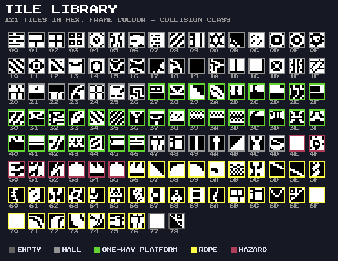
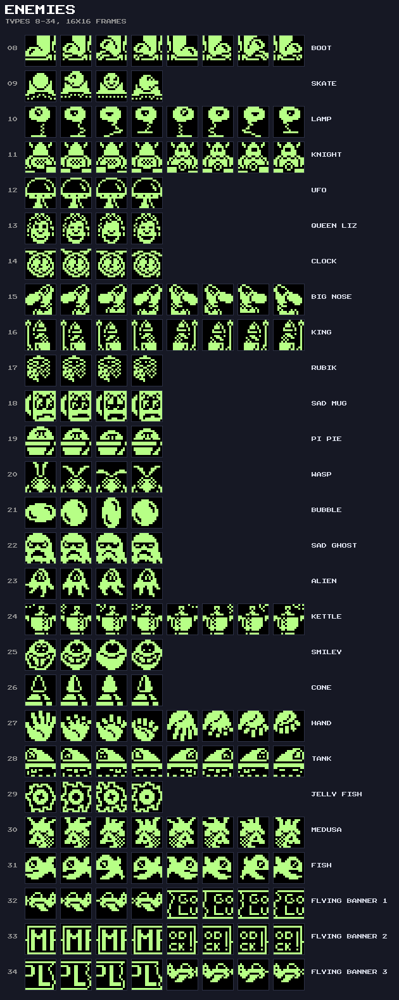
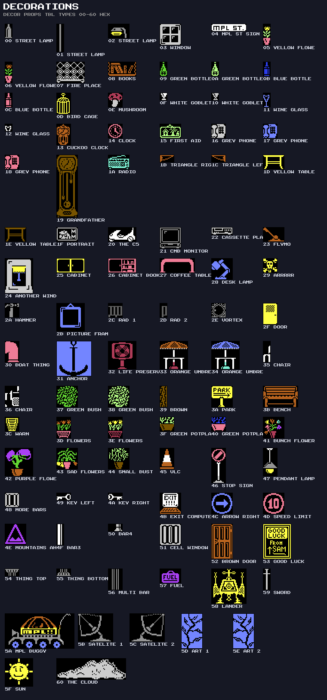

# Monty on the Run – Data Formats

The layout of every table the game reads, with the routine that reads it. Addresses are those of the original image
(`byte-perfect/src/motr.asm`); all values are hexadecimal unless stated. The tools in `tools/` decode these formats from
the assembled image, and `just docs-verify` checks the room decoder against the game's own output.

---

## The Level-Data Index (`$9600`)

| Address | Label                    | Points at                                 | Size / entries       |
| :------ | :----------------------- | :---------------------------------------- | :------------------- |
| `$9600` | `room_entity_master_ptr` | `entity_master_tbl` (`$CF32`): coins      | 3-byte records       |
| `$9602` | `fk_sprite_src_base`     | `freedom_kit_sprites` (`$CC72`)           | 22 × 32 bytes        |
| `$9604` | `attract_chr_src_ptr`    | `attract_chr_src` (`$C9FA`)               | title charset blocks |
| `$9606` | `room_tileset_ptr`       | `tile_library` (`$AD3B`)                  | 121 × 8 bytes        |
| `$9608` | `room_def_ptr`           | `room_def_tbl` (`$C6BA`)                  | 52 × 16 bytes        |
| `$960A` | `room_tilemap_ptrs`      | 52 inline pointers to the tile maps       | `$9710–$AD3A`        |
| `$9672` | `enemy_spr_ptrs`         | 27 inline pointers, enemy types 8–34      | packed sprite banks  |
| `$96A8` | `room_enemy_ptrs`        | 52 inline pointers to enemy start records | `$C203–$C6B9`        |

The first five are pointers to pointers; the other three are tables of pointers in place.

---

## Rooms

### Room Record (`room_def_tbl`, 16 Bytes)

Read by `LoadRoom` at `room_def_tbl + room × 16`.

| Bytes | Meaning                                                                   |
| :---- | :------------------------------------------------------------------------ |
| 0–7   | Tile-library numbers (`$00–$78`) for characters 1–8 (`room_tile_chr_tbl`) |
| 8–15  | Colour of characters 1–8 (`zp_room_colour_tbl`), C64 colour 0–15          |

### Tile Map (Run-Length Coded)

`DrawRoomPlayfield` decodes the stream at `room_tilemap_ptrs[room]` into a 32 × 20 buffer at `$0400`, then copies it to
the screen from row 3, column 4.

| Byte         | Meaning                                                            |
| :----------- | :----------------------------------------------------------------- |
| `%rrrr tttt` | Repeat tile `t` (`0–F`, stored as the screen code) `r + 1` times   |
| `$FF $FF`    | End of the map. A single `$FF` is an ordinary run (16 × tile `$F`) |

Codes 1–8 are the room's tiles and 0 is the blank background. The format allows codes 9–15, but no room uses them (and
they would get no colour or collision class: `PopulateColourRam` and `GetTileCollisionFlag` handle only 1–8).
`CreatePlayfieldBorder` then copies column 4 into columns 2–3 and column 35 into columns 36–37 on every row, so the
playfield is 36 characters wide on screen.

### Tile Library and Collision Classes

`tile_library` holds 121 tiles of 8 bytes, hires (one bit per pixel). `SetupTileGraphics` copies a room's eight into
characters 1–8. `SetTileProperty` gives each a collision class from its *library number*:

| Library numbers      | Class | Meaning          |
| :------------------- | :---- | :--------------- |
| `$00–$26`, `$47–$4D` | 1     | Wall             |
| `$27–$46`            | 2     | One-way platform |
| `$56–$76`            | 3     | Rope             |
| `$4E–$55`            | 4     | Hazard (kills)   |
| `$77–$78`            | 0     | Empty            |

### Animated Tile (`room_metadata_tbl`, `$2152`, 1 Byte per Room)

| Bits | Meaning                                                     |
| :--- | :---------------------------------------------------------- |
| 0–2  | Which room tile animates: character 1 + value               |
| 4    | `RorBytes3`: rotate rows 0–2 one pixel right (moving water) |
| 5    | `RolBytes3`: rotate rows 0–2 one pixel left (moving water)  |
| 6    | `RotateBufferRight8`: cycle the eight rows downwards (lava) |
| 7    | `RotateBufferLeft8`: cycle the eight rows upwards (lava)    |

`AnimateThemeChar` applies it on odd frames. In each hazard room the animated tile is the hazard, but the byte also
animates harmless tiles.

### Room Grid (`room_exit_dest_tbl`, `$187A`)

Six rows of 23 bytes, one per map cell: a room number, or `$FF` for none. `zp_map_row` and `zp_exit_tile_col` hold
Monty's cell, and walking off a screen edge steps the column (or row) and calls `GetRoomID`, which reads
`room_exit_dest_tbl[room_exit_offset_tbl[row] + column]`. `room_exit_offset_tbl` (`$192D`) has seven entries; the
seventh (`$8A`) points past the grid and is never used. Room `$30` (the ending) is not on the grid.

The cell at row 2, column 4 (`room_exit_dest_dyn`, `$18AC`) is written at run time: `startGame` sets it to `$33`, and
the C5 code sets it to `$FF` once Monty has driven back, closing that way.

### Coins (`entity_master_tbl`, `$CF32`)

3-byte records, `$FF`-terminated: room, column, row. The position is relative to the playfield (screen row 3 + row,
column 4 + column). `RoomEntitiesInit` places character `$34` at each one not yet collected
(`room_entity_collected_tbl`, one flag per coin: 64 coins) and keeps colour-RAM pointers for the colour cycle.

### Sector Names (`sector_name_tbl`, `$19E3`)

Ten records of a column byte, then ASCII text, then `*`. `room_msg_idx_tbl` (`$1AA2`) gives each room an index;
`DisplaySectorName` skips that many `*` from the start and prints the name on row 24. Fourteen spare `*` follow the last
name.

---

## Enemies

### Start Record (`room_enemy_ptrs[room]`, 7 Bytes, `$FF`-Terminated)

| Byte | Meaning                                                   | Becomes slot byte |
| :--- | :-------------------------------------------------------- | :---------------- |
| 0    | Colour index, through `enemy_sprite_colour_tbl` (`$131E`) | +2                |
| 1    | X: sprite X = byte ÷ 2 + `$1C`                            | +0                |
| 2    | Y: sprite Y = `$F9` − byte                                | +1                |
| 3    | Direction index, through `enemy_dir_flags_tbl` (`$1319`)  | +4                |
| 4    | Type, 8–34: which sprite bank                             | +3                |
| 5    | Speed                                                     | +7                |
| 6    | Range: steps before turning                               | +5                |

`SetupRoom` fills `enemy_state_tbl` (`$0200`) in order. It has four 8-byte slots and no bounds check; no room has more
than four records. Slot byte +6, the step counter, starts at 0, or at the range if the direction starts reversed.

`enemy_dir_flags_tbl` = `$00 $82 $02 $81 $01`. Bit 0 is the axis (1 = vertical), bit 7 the direction (1 = reversed). Bit
1 is never tested, so indices 0 and 2 behave alike.

### Sprite Banks (`enemy_spr_ptrs`)

Each type points at 256 bytes of packed graphics: eight frames of 32 bytes, each a 16 × 16 hires image.
`UnpackSpriteGraphics` copies a frame into the buffer at `$022C` and `DeinterleaveSpriteRow` expands it into a 64-byte
sprite block:

| Packed bytes | Sprite rows | Sprite columns |
| :----------- | :---------- | :------------- |
| 0–7          | 0–7         | left byte      |
| 8–15         | 0–7         | middle byte    |
| 16–23        | 8–15        | left byte      |
| 24–31        | 8–15        | middle byte    |

The right byte and rows 16–20 stay blank. Slot `n` goes to `$4C00 + n × $200` (sprite pointers `$30 + n × 8`). When
`enemy_copy_flag_tbl[type − 8]` (`$132E`) is set, the type has only four frames (128 bytes): the first four frames are
copied over the last four. An enemy moving forwards shows frames 4–7, reversed 0–3. Types 8–31 are at `$B103`; types
32–34 point into VIC bank 1 at `$7800` (the GOOD LUCK banner and the MPL logo).

---

## Items and Mechanisms

### Special Items (`si_spawn_tbl`, `$25E6`, 20 × 4 Bytes)

| Byte | Meaning                              |
| :--- | :----------------------------------- |
| 0    | Room                                 |
| 1, 2 | Sprite X, Y                          |
| 3    | Frame: sprite pointer = byte + `$8E` |

The item's index is its slot in `si_collected_tbl` (`$0308`, `$81` = collected). The effects are coded in
`HandleSICollision` and `ApplyItemRoomEffects`, not in the table (see [GAMEPLAY.md](GAMEPLAY.md)).

### Teleporters

`teleporter_data` (`$1F39`): 5-byte records, `$FF`-terminated: room, screen address of the column (lo, hi), height,
colour. `teleporter_dest_tbl` (`$2895`): 4 bytes per teleporter, in the same order: Monty's X and Y, then the grid
column and **row** to arrive at (the source's comment calls the last byte a room number). `CheckTeleporterContact`
stores them in `zp_monty_sprite_x2/y2`, `zp_exit_tile_col` and `zp_map_row`, then sets `zp_room_exit`.

### Piledrivers (`piledriver_config_tbl`, `$1BCA`)

5-byte records, `$FF`-terminated: room, column, row, height in rows, first character. Each room may have two (drivers 0
and 1, animated in characters `$10–$1F` and `$20–$33`).

### Decorations (`$E000–$FF72`)

| Part              | Address       | Format                                                       |
| :---------------- | :------------ | :----------------------------------------------------------- |
| Header            | `$E000`       | Pointer to `decor_props_tbl`, pointer to `decor_room_list`   |
| Type records      | `$E004`       | 97 × 4 bytes: bitmap pointer, colour pointer                 |
| Bitmaps, colours  | `$E188–$F9CD` | 8 bytes per character; one colour byte per character         |
| `decor_props_tbl` | `$F9CE`       | 97 × 4 bytes: width, height, width × height, first character |
| `decor_room_list` | `$FB56`       | 4-byte records, `$FF`-terminated: room, column, row, type    |

`CalculateRoomDecorations` walks the room list. The first time a type appears in a room, `InitDecorationPattern` copies
its bitmap into the next free characters from `$9B` and records the first one in props byte 3 (the table is written at
run time). `DrawDecoration` then fills the rectangle left to right, top to bottom, with consecutive characters. A colour
pointer whose high byte is 0 means one solid colour (the low byte); otherwise it points at one colour byte per
character. Column and row are screen positions. The characters run out at `$FE`; a decoration that does not fit is still
drawn, with whatever characters are there.

---

## Freedom Kit

| Table                  | Address | Format                                                               |
| :--------------------- | :------ | :------------------------------------------------------------------- |
| `freedom_kit_sprites`  | `$CC72` | 22 icons × 32 bytes (16 × 16 hires); item 21 is the carousel mask    |
| `fk_sprite_layout_tbl` | `$34D9` | 32 offsets: where each icon byte goes in a 64-byte sprite block      |
| `freedom_kit_contents` | `$3527` | The five packed items (factory: 5 9 16 19 2, none of the right ones) |
| `fk_item_flags`        | `$352C` | 22 bytes: `$FF` on the carousel, `$00` packed                        |
| `fk_item_slot_idx`     | `$25E1` | The five items the game checks: 1, 3, 11, 12, 15                     |
| `fk_room_item_active`  | `$031D` | At game start: `$FF` for each of those five that is packed           |

---

## Hi-Scores (`$7300`)

| Part                     | Address | Format                                              |
| :----------------------- | :------ | :-------------------------------------------------- |
| `hiscore_score_table`    | `$7300` | 50 × 5 ASCII digits, highest first                  |
| `hiscore_score_overflow` | `$73FA` | 5 bytes that catch the entry shifted off the bottom |
| `hiscore_name_table`     | `$73FF` | 50 × 16 characters                                  |
| `hiscore_name_input_buf` | `$771F` | 13-byte work buffer                                 |

The score in play (`$0294–$0298`) uses the same ASCII digits, so both copy to the screen unchanged. `hi_score_triggers`
(`$08BB`) is a list of `$00`-separated words ending `$FF`; `hi_score_replacements` (`$0974`) holds 16 replacement names
of 16 characters for triggers 10–25.

---

## Title Scroller (`scroll_msg_text`, `$3A59`)

ASCII text, drawn from the game's own font at `$4000` with each font pixel plotted as a quarter-character block
(`ScrollPlotPixel`), with control codes:

| Code     | Meaning                                           |
| :------- | :------------------------------------------------ |
| `$FE nn` | Colour `nn`                                       |
| `$FD nn` | Direction: bit 7 set = scroll left, clear = right |
| `$FC nn` | Speed `nn`                                        |
| `$FB`    | Scroll the text area up 9 rows                    |
| `$FA`    | Scroll it down 9 rows                             |
| `$F9 nn` | Pause `nn` frames                                 |
| `$FF`    | Restart the message                               |

The closing "!KCUL DOOG" is stored backwards because it scrolls the other way.

---

## Music and Sound Effects

The song, track, pattern, instrument and effect formats are in [SOUND.md](SOUND.md), and the decoded data in
[SOUND_DATA.md](SOUND_DATA.md).
