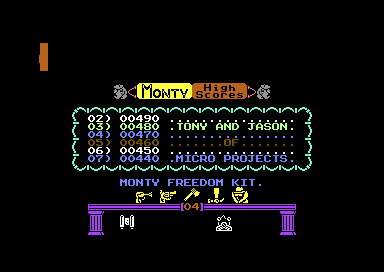
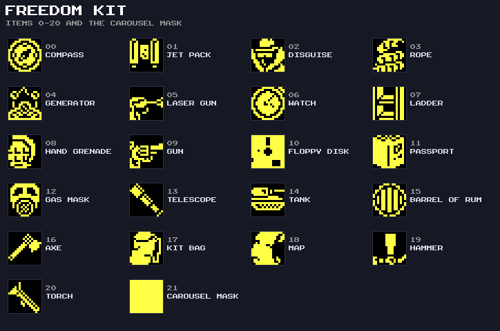
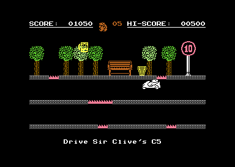
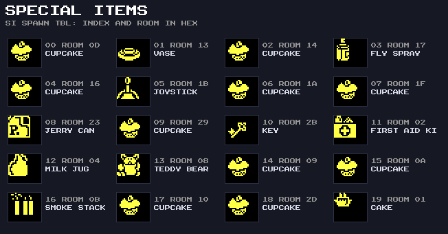
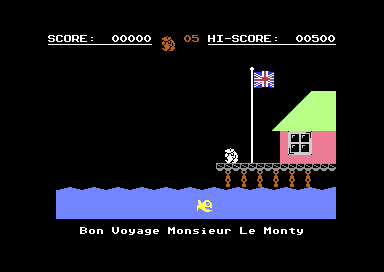
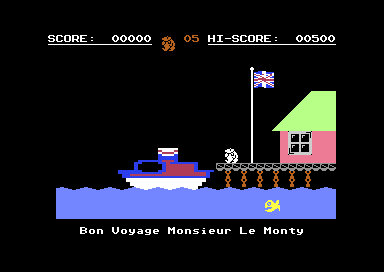
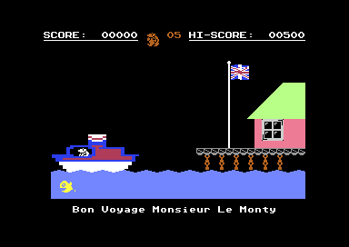
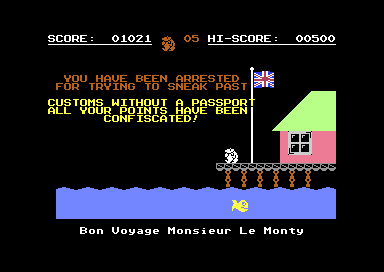
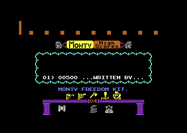

# Monty on the Run – Gameplay

What the player sees and does, described from the code. Room numbers are hexadecimal, as the game stores them;
[ROOMS.md](ROOMS.md) has a screenshot and the data for every room, and [GRAPHICS.md](GRAPHICS.md) the sprites, tiles and
decorations.

---

## The Story

The title scroller tells it: *thanks to the help of Sam Stoat, Monty has escaped from the hell of Scudmore Prison. Now
free to continue his adventures, Monty must search for a boat to take him to safety.* Before he runs, the player packs a
**Freedom Kit** of five items from twenty-one. Only the right five get him out of the country.

The game is a flip-screen platformer of 52 rooms. Monty starts in room `$00` (The House, at the east end of the map) and
works west and down through the tunnels and sewers, up the tree stump, along the road in Sir Clive's C5 and onto the
boat. On the boat he finds the treasure, and touching it ends the game: escape to France, or arrest at customs.

---

## Controls

| Input               | Action                                               |
| :------------------ | :--------------------------------------------------- |
| Joystick, port 2    | Walk, climb, jump (fire), fly the jetpack            |
| Z X ; / SPACE       | Keyboard left, right, up, down, fire (redefinable)   |
| P                   | Pause; P again resumes (sound is muted while paused) |
| RESTORE             | Abandon the game: score cleared, back to the title   |
| Title: left / right | Turn the Freedom Kit carousel                        |
| Title: down         | Pack the item under the marker into the kit          |
| Title: fire         | Start the game                                       |
| Title: F1           | Toggle music / sound effects                         |
| Title: R            | Redefine the five keys                               |

The joystick is read first (`ReadPlayerInput`); only when it is centred and the button is up are the five keyboard
controls scanned. `JOYSTICK_PORT` in the source selects port 1 instead.

In **music mode** (the default) the main theme plays through the game, and only the effects that don't compete with it
are heard. In **sound-effect mode** (F1 on the title) the jump, jetpack and piledriver sounds are added. RESTORE does
nothing on the title. A RESET lands on the "THAT WAS SILLY, NO HACKING PLEASE !" screen, which loops forever (see
[ARCHITECTURE.md](ARCHITECTURE.md#protection)).

---

## The Freedom Kit

On the title screen the carousel shows the 21 items six at a time. Pressing down packs the item under the marker: the
five-slot kit shifts along, the oldest item drops out and goes back on the carousel. The kit starts as **laser gun, gun,
axe, hammer and disguise**: the wrong five.

The game checks exactly five items, through `fk_item_slot_idx` (`InitRoomItemFlags`), and the other sixteen do nothing:

| Item          | What it does                                                      |
| :------------ | :---------------------------------------------------------------- |
| Jet pack      | Monty can fly in rooms `$1D`–`$20` (The Ultimate Experience)      |
| Rope          | A rope hangs from the top of room `$22`, the way up to room `$23` |
| Gas mask      | Lets the cupcake in room `$14` clear the second wall there        |
| Barrel of rum | With the key, removes Queen Liz from room `$2F`                   |
| Passport      | Decides the ending: freedom with it, arrest without it            |

---

## Moving Around

Monty walks, climbs ropes, falls and jumps. A jump is a fixed arc from `jump_arc_tbl` (22 steps up, 17 down), shown as a
somersault. Each room is drawn from eight tiles, and each tile has a collision class fixed by its tile-library number:

| Class            | Effect                                             |
| :--------------- | :------------------------------------------------- |
| Wall             | Blocks movement in every direction                 |
| One-way platform | Stands on it, jumps up through it                  |
| Rope             | Climbable                                          |
| Hazard           | Kills: water (animated sideways) or lava (up/down) |
| Empty            | Background                                         |

Leaving the screen at an edge moves Monty one step across the room grid (`room_exit_dest_tbl`, 6 rows by 23 columns).
The [world map](ROOMS.md) shows the layout.

### Mechanisms

| Mechanism      | Rooms                                           | Behaviour                                                                                       |
| :------------- | :---------------------------------------------- | :---------------------------------------------------------------------------------------------- |
| Lift (type 1)  | `$05`                                           | Rides up, then comes back down and crushes Monty if he is still on it. Kills even in cheat mode |
| Lift (type 2)  | `$0D`                                           | Waits, then carries Monty down                                                                  |
| Piledrivers    | `$01` `$02` `$06` `$0B` `$13` `$19` `$1B` `$28` | Drop on a random timer; standing under the column kills                                         |
| Rising bollard | `$0C`                                           | Lifts Monty up (`UpdatePiledriverRide`)                                                         |
| Teleporters    | `$08` `$14` `$1C` `$2A`                         | Warp to `$06` `$13` `$1B` `$29`; not while the pad shows its starting colour                    |
| Rising cloud   | `$01`                                           | A sprite cloud that rises up the room                                                           |
| Jetpack        | `$1D`–`$20`                                     | Needs the jet pack in the kit                                                                   |
| Sir Clive's C5 | `$24` `$25` `$31`–`$33`                         | Monty rides the C5 along the road; it can crash                                                 |

### The C5 Road

The road runs west along map row 2: `$24`, `$25`, `$31`, `$32`, `$33`, then on foot into `$26`. In room `$24` Monty
drops into the parked C5 and drives it west. In room `$33` he gets out, and reaching the left edge puts him in room
`$26` (`C5CheckReturnTeleport`). That also writes `$FF` into the map cell that holds `$33` (`room_exit_dest_dyn`), so
the road can't be driven again in that game; `startGame` puts `$33` back.

Rooms `$31`–`$33` are the last three screens before the boat, but they are numbered after the ending room `$30`. The
code and data suggest they were added late, to lengthen the road: see
[VERIFICATION.md](VERIFICATION.md#the-late-c5-rooms).

---

## Things to Collect

**Coins** (64 in all, in 38 rooms) are worth 50 points each. **Special items** (`si_spawn_tbl`, 20 of them) are worth
200 each, and some change other rooms when they are picked up:

| Item                     | Room    | Effect                                                               |
| :----------------------- | :------ | :------------------------------------------------------------------- |
| Cupcake                  | `$0D`   | Clears a block in room `$0C`                                         |
| Vase                     | `$13`   | Clears a wall in room `$14`                                          |
| Cupcake                  | `$14`   | Clears a second wall in `$14`, but only with the gas mask in the kit |
| Fly spray                | `$17`   | Removes the wasp from room `$19`                                     |
| Joystick                 | `$1B`   | Closes the gap in the floor of room `$1C`                            |
| Jerry can                | `$23`   | Makes the treasure appear in room `$2F`                              |
| Key                      | `$2B`   | With the barrel of rum, removes Queen Liz from room `$2F`            |
| First aid kit            | `$02`   | An extra life                                                        |
| Teddy bear               | `$08`   | A trap: wakes the bubble in room `$08`                               |
| Smoke stack              | `$0B`   | A trap: kills Monty (after the 200 points)                           |
| Milk jug, other cupcakes | various | Points only                                                          |
| Cake                     | `$01`   | Only appears in cheat mode; eating it turns invincibility on         |

---

## Lives and Death

Monty has five lives (`STARTING_LIVES`). Each death has its own animation and sound, from `MontyEventDispatch`:

| Event | Cause                                     | Animation                       | Sound |
| :---- | :---------------------------------------- | :------------------------------ | :---- |
| 1     | Smoke stack, or under a piledriver column | Monty splits into four pieces   | `$09` |
| 2     | An enemy                                  | Dissolves (60 frames)           | `$0A` |
| 3     | The type-1 lift                           | Squashed flat                   | `$0E` |
| 4     | The three piledriver bases in room `$1F`  | Sinks and dissolves (48 frames) | `$0C` |
| 5     | Water or lava                             | Sinks (18 frames)               | `$0D` |
| 7     | Crashing the C5                           | Back to a fixed start position  | `$0E` |

After a death Monty restarts at the position where he entered the room. With no lives left, sprites spelling GAME and
OVER fly together and apart, and the game returns to the title.

---

## The Ending

Collecting the **jerry can** in room `$23` makes the treasure appear in room `$2F`, beside Queen Liz. She can't be
jumped past; the **key** from room `$2B` removes her, but only if the **barrel of rum** is in the kit. Touching the
treasure (event 6) runs `FreedomSequence`. It stops play and loads room `$30`, *Bon Voyage Monsieur le Monty*, which is
on no map row. Waves roll along the water, the Union Jack waves on the flagpole, song 2 plays and Monty walks out onto
the jetty:

The passport decides the rest (`fk_room_item_active+2`).

**With the passport**, the boat comes in, Monty steps aboard, and the boat sails off to the left with him:

**Without it**, the message "YOU HAVE BEEN ARRESTED FOR TRYING TO SNEAK PAST CUSTOMS WITHOUT A PASSPORT. ALL YOUR POINTS
HAVE BEEN CONFISCATED!" appears, and after a pause the score counts down to zero, one point every two frames
(`ConfiscateScore`):

Either way the game then goes to the GAME OVER sequence and the hi-score table. The screenshots come from
`tools/capture_screens.py`, which starts the ending from room `$00` of a new game with a score of 01050; in a real
finish the HUD shows the player's own score.

---

## Hi-Scores and Name Entry

The table holds 50 scores. Its factory names spell out the credits — *written by Tony and Jason of Micro Projects for
Gremlin Graphics, July 1985* — then a block-letter MPL and two arrows. A qualifying score asks for a name of up to 16
characters: RETURN confirms, DEL rubs out.

`ProcessHiScoreName` checks the name against a list of words (`hi_score_triggers`). Ten rude words are censored (their
second and third letters become `"`), and fifteen others replace the name with a joke. A trigger matches anywhere in the
name, so SCARY becomes PEUGEOT 205 GTI!:

| Name typed | Shown as         | Name typed      | Shown as                          |
| :--------- | :--------------- | :-------------- | :-------------------------------- |
| CAR        | PEUGEOT 205 GTI! | MINTER          | THE HAIRY BEAST.                  |
| XR2        | XR2 - THE BEST!! | (no name)       | A.N.ONYMOUS ! or THE NAMELESS ONE |
| CTW        | SCIALOM FOR GOD! | SPECTRUM        | A LUMP OF JUNK !                  |
| PURPLE     | KNEBWORTH 22/6   | I WANT TO CHEAT | YESSUM BOSS !!                    |
| MUSIC      | MAGNUM WKFM LP34 | GEZ             | MR COOL !!                        |
| DRUMS      | PHILIP  HARRISON | MADONNA         | PENTHOUSE 1/8/85                  |
| WINE       | SCOTTS , OK YAH! | II SHY          | THANKS UNCLE A.                   |
| FRANKIE    | YUK,ERR,OH NO. ! |                 |                                   |

---

## The Cheat

Typing **I WANT TO CHEAT** as a hi-score name flashes the border and sets `cheatmode` to `$01`. That alone only makes a
cake appear in room `$01`. **Eating the cake** sets bit 7 (`cheatmode` = `$81`), and it is bit 7 the game tests: deaths
are skipped (except the lift squash and the ending), the C5 cannot crash and the piledrivers show a different frame.
RUN/STOP + RESTORE, or losing the last life, turns the cheat off again.
