# Monty on the Run – Screens and Graphics

The screen layout, the character set, tiles, decorations and every sprite, decoded from the assembled image by
`tools/render_graphics.py`. The screenshots are taken in VICE by `tools/capture_screens.py`, which drives the game's own
code. Every room is in [ROOMS.md](ROOMS.md); the formats behind the figures are in [DATA_FORMATS.md](DATA_FORMATS.md).

---

## Display Set-Up

The game uses standard hires text mode in VIC bank 1: screen RAM at `$4800`, the character set at `$4000`, sprite
pointers at `$4BF8`, and black border and background. There is no multicolour text and no bitmap mode; every character
cell has one colour from colour RAM. The game is flip-screen: only the title uses fine scrolling.

### The Game Screen

| Rows | Columns    | Content                                                           |
| :--- | :--------- | :---------------------------------------------------------------- |
| 0    | 2–37       | `SCORE:`, the lives counter, `HI-SCORE:` (`DrawGameScreenHeader`) |
| 1    | 2–37       | A ruled line, broken where the lives are shown                    |
| 3–22 | 4–35       | The 32 × 20 playfield                                             |
| 3–22 | 2–3, 36–37 | Gutters: copies of the outermost playfield columns                |
| 24   | –          | The sector name                                                   |

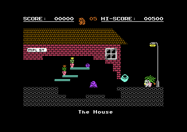

The room decoder rebuilds the same playfield from the data without running the game. Sprites (Monty, enemies, items) are
not part of the character screen:

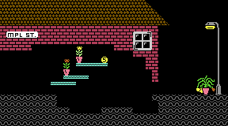

### The Title Screen

The attract screen splits at raster lines 90 and 251. The top half carries a scroller drawn in quarter-character blocks
from the game's font, smooth-scrolled with `$D016`. Below it are the hi-score box (which alternates with the credits
table) and the Freedom Kit carousel: six item sprites between two mask sprites, with the item number under the marker.

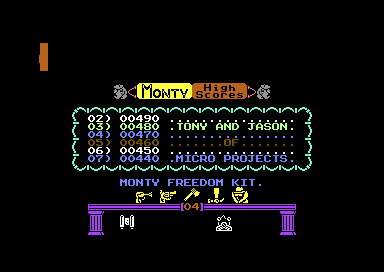

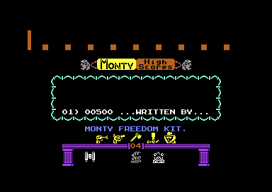

---

## Character Set

`$4000–$47FF` holds 256 characters. The font (A–Z, digits, punctuation) is at `$40–$7F`, so the game turns ASCII into
screen codes with `AND #$3F` / `ORA #$40`. At run time:

| Characters           | Use                                                                       |
| :------------------- | :------------------------------------------------------------------------ |
| `$00`                | Blank                                                                     |
| `$01–$08`            | The room's eight tiles (`SetupTileGraphics`)                              |
| `$10–$33`            | Piledriver shafts, redrawn as they move                                   |
| `$34`                | Coin                                                                      |
| `$38–$3B`            | Teleporter column                                                         |
| `$40–$7F`            | Font                                                                      |
| `$9B–$FE`            | Decorations, allocated per room                                           |
| `$16–$2B`, `$C8–$FF` | Title-screen graphics, copied in from `$C9FA` (`UpdateAttractScreenChrs`) |

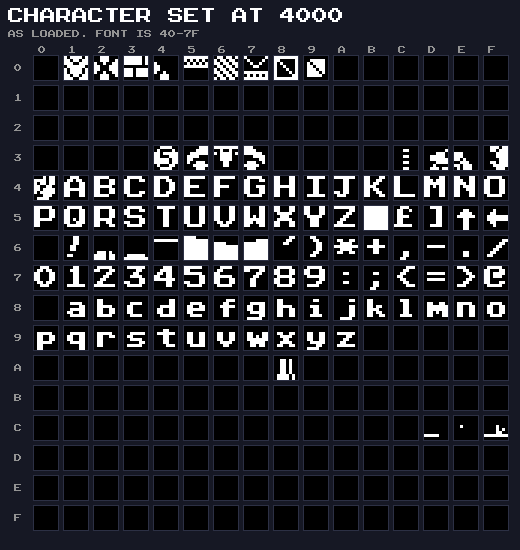

---

## Tiles

Every room is drawn from eight of the 121 tiles in the library. The frame colour shows each tile's collision class (see
[GAMEPLAY.md](GAMEPLAY.md#moving-around)): grey walls, green one-way platforms, yellow ropes, red hazards.

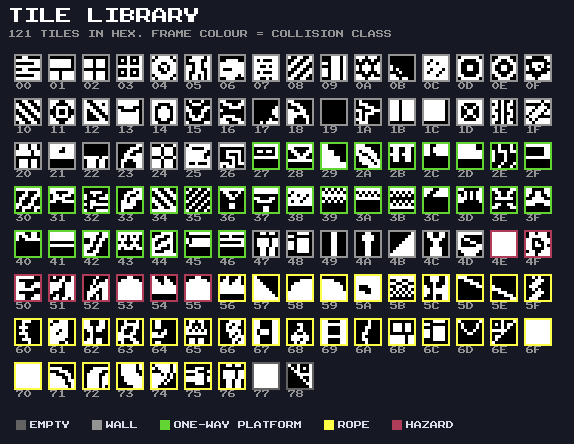

---

## Decorations

The furniture of the world (lamps, windows, clocks, the C5, the MPL buggy, a satellite dish) is 97 decoration types.
Each is a block of characters with its own colours, placed by `decor_room_list` (262 placements; 82 types are used). Two
of them are cameos. *GOOD LUCK FROM SAM* is from Sam Stoat, who helped Monty escape; *Thing Top* and *Thing Bottom* show
Thing, from Gremlin's *Thing on a Spring*.

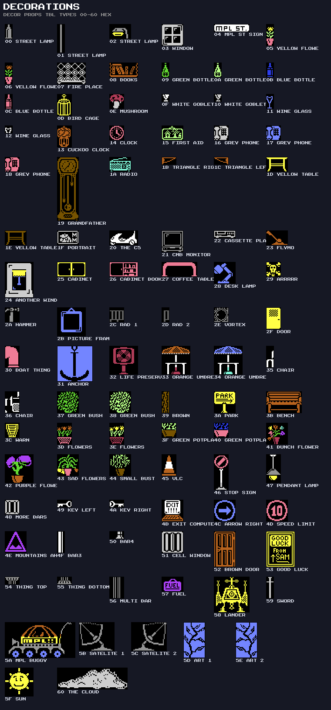

---

## Sprites

All sprites live in VIC bank 1. A frame's pointer is its address minus `$4000`, divided by 64. Most are hires; the lift,
the Union Jack and the lift-squash splat are multicolour.

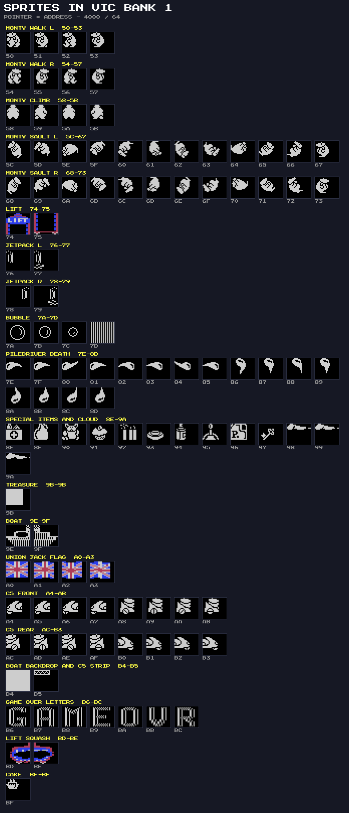

| Pointers  | Frames                                                                 |
| :-------- | :--------------------------------------------------------------------- |
| `$30–$4F` | Enemy slots 0–3, unpacked per room at `$4C00`                          |
| `$50–$73` | Monty: walk left and right, climb, somersault left and right (12 each) |
| `$74–$75` | Lift                                                                   |
| `$76–$79` | Jetpack, left and right                                                |
| `$7A–$7C` | Bubble (`$7D` is unlabelled)                                           |
| `$7E–$8D` | Piledriver death                                                       |
| `$8E–$9A` | Special items, then the rising cloud (3 frames)                        |
| `$9B`     | Treasure (a solid block, colour-cycled)                                |
| `$9C–$9D` | Dissolve buffers                                                       |
| `$9E–$9F` | Boat (ending)                                                          |
| `$A0–$A3` | Union Jack (ending)                                                    |
| `$A4–$B3` | C5: front half `$A4–$AB`, rear half `$AC–$B3`; left `+0`, right `+4`   |
| `$B4–$B5` | Backdrop behind the boat; the strip in the C5 rooms                    |
| `$B6–$BC` | GAME OVER letters (G A M E O V R, with E reused)                       |
| `$BD–$BE` | Monty squashed by the lift                                             |
| `$BF`     | The secret cake                                                        |

### Monty

| Walking left                                           | Walking right                                            | Climbing                                       | Somersault                                               |
| :----------------------------------------------------- | :------------------------------------------------------- | :--------------------------------------------- | :------------------------------------------------------- |
| 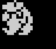 | 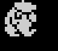 | 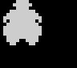 | 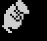 |

### Enemies

The 27 enemy types are stored packed, eight 16 × 16 frames to 256 bytes, and unpacked into sprite blocks when a room is
entered. Fourteen are four-frame types whose frames are copied to fill eight. Types 32–34 aren't monsters: they are a
small plane and the pieces of the banners it tows, GOOD LUCK and MPL (Micro Projects Ltd), flying across the sky in room
`$23`.

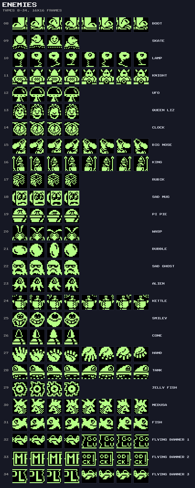

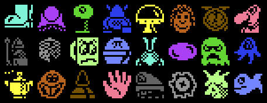

### Items and the Ending

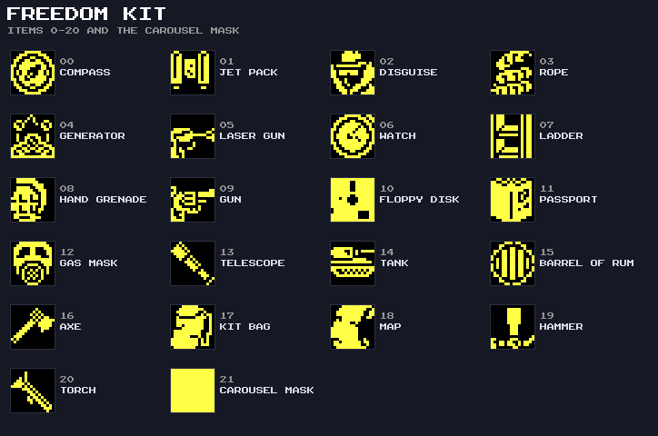

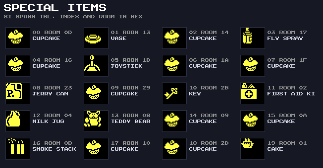

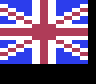

---

## The World

The 51 rooms on the grid, from the VICE screenshots placed by `room_exit_dest_tbl`. Monty starts at the right (`$00`)
and the boat is at the left (`$2F`); room `$30`, the ending, is not on the grid.

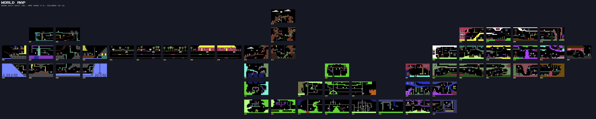
