# Monty on the Run – Room Atlas

Generated by `tools/render_graphics.py` from `build/motr.prg`: do not edit by hand. Every room as the game's own `LoadRoom` builds it (VICE screenshots from `tools/capture_screens.py`), with the data that drives it. Room numbers and map positions are hexadecimal; formats are in [DATA_FORMATS.md](DATA_FORMATS.md).

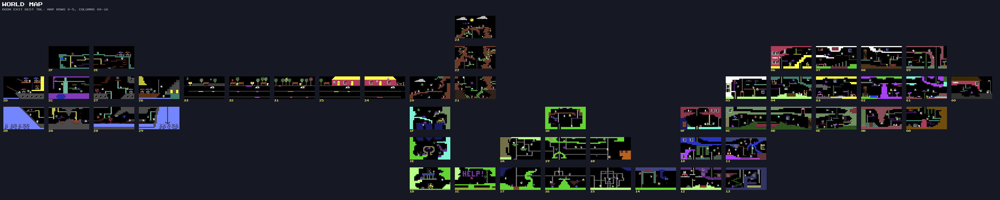

| Room  | Sector                       | Map row, column | Enemies | Coins | Hazard tiles | Special                                                                                                                  |
| :---- | :--------------------------- | :-------------- | ------: | ----: | :----------- | :----------------------------------------------------------------------------------------------------------------------- |
| `$00` | THE HOUSE                    | 2, `$15`        | 2       | 1     | –            | –                                                                                                                        |
| `$01` | THE HOUSE                    | 2, `$14`        | 3       | 3     | `55`         | piledriver (column 7, row 5, 4 rows); piledriver (column 31, row 12, 6 rows); rising cloud platform (sprite 1); #19 cake |
| `$02` | THE HOUSE                    | 2, `$13`        | 4       | 2     | `55`         | piledriver (column 21, row 5, 4 rows); #11 first aid kit                                                                 |
| `$03` | THE HOUSE                    | 2, `$12`        | 4       | 2     | `55`         | –                                                                                                                        |
| `$04` | THE HOUSE                    | 2, `$11`        | 4       | 1     | `4F`         | #12 milk jug                                                                                                             |
| `$05` | THE HALL OF JOW-AN           | 2, `$10`        | 4       | 2     | –            | lift, type 1: rides up then crushes you on the way back                                                                  |
| `$06` | THE HOUSE                    | 1, `$11`        | 3       | 2     | –            | piledriver (column 13, row 6, 4 rows)                                                                                    |
| `$07` | THE HOUSE                    | 1, `$12`        | 4       | 0     | `4F`         | –                                                                                                                        |
| `$08` | PIE ARE SQUARE               | 1, `$13`        | 4       | 1     | `4F`         | teleporter to room `$06`; #13 teddy bear                                                                                 |
| `$09` | THE HOUSE                    | 1, `$14`        | 3       | 0     | `4F`         | #14 cupcake                                                                                                              |
| `$0A` | THE HOUSE                    | 3, `$14`        | 4       | 2     | –            | #15 cupcake                                                                                                              |
| `$0B` | THE HOUSE                    | 3, `$13`        | 2       | 0     | `51`         | piledriver (column 19, row 17, 4 rows); #16 smoke stack                                                                  |
| `$0C` | THE HOUSE                    | 3, `$10`        | 4       | 0     | `4F`         | rising bollard (piledriver ride code, upwards)                                                                           |
| `$0D` | THE HOUSE                    | 3, `$11`        | 2       | 1     | `4F`         | lift, type 2: carries you down; #0 cupcake                                                                               |
| `$0E` | THE HOUSE                    | 3, `$12`        | 3       | 1     | `4F`         | –                                                                                                                        |
| `$0F` | ESCAPE TUNNEL                | 3, `$0F`        | 4       | 2     | –            | –                                                                                                                        |
| `$10` | ESCAPE TUNNEL                | 4, `$0F`        | 3       | 0     | `53`         | #17 cupcake                                                                                                              |
| `$11` | ESCAPE TUNNEL                | 4, `$10`        | 4       | 2     | `54`         | –                                                                                                                        |
| `$12` | ESCAPE TUNNEL                | 5, `$0F`        | 2       | 3     | `4F`         | –                                                                                                                        |
| `$13` | ESCAPE TUNNEL                | 5, `$10`        | 3       | 2     | `4F`         | piledriver (column 24, row 13, 3 rows); #1 vase                                                                          |
| `$14` | SEWERAGE WORKS               | 5, `$0E`        | 3       | 1     | `4F`         | teleporter to room `$13`; #2 cupcake                                                                                     |
| `$15` | SEWERAGE WORKS               | 5, `$0D`        | 4       | 3     | –            | –                                                                                                                        |
| `$16` | SEWERAGE WORKS               | 5, `$0C`        | 4       | 2     | –            | #4 cupcake                                                                                                               |
| `$17` | SEWERAGE WORKS               | 5, `$0B`        | 4       | 1     | `4F`         | #3 fly spray                                                                                                             |
| `$18` | SEWERAGE WORKS               | 4, `$0D`        | 4       | 2     | `51`         | –                                                                                                                        |
| `$19` | SEWERAGE WORKS               | 4, `$0C`        | 4       | 1     | `4F`         | piledriver (column 26, row 4, 3 rows)                                                                                    |
| `$1A` | SEWERAGE WORKS               | 4, `$0B`        | 4       | 1     | –            | #6 cupcake                                                                                                               |
| `$1B` | SEWERAGE WORKS               | 3, `$0C`        | 4       | 3     | –            | piledriver (column 15, row 4, 4 rows); piledriver (column 21, row 4, 4 rows); #5 joystick                                |
| `$1C` | SEWERAGE WORKS               | 5, `$0A`        | 3       | 1     | `54`         | teleporter to room `$1B`                                                                                                 |
| `$1D` | THE ULTIMATE EXPERIENCE      | 5, `$09`        | 3       | 3     | –            | jetpack, if the jet pack is in the Freedom Kit                                                                           |
| `$1E` | THE ULTIMATE EXPERIENCE      | 4, `$09`        | 4       | 3     | –            | jetpack, if the jet pack is in the Freedom Kit                                                                           |
| `$1F` | THE ULTIMATE EXPERIENCE      | 3, `$09`        | 4       | 2     | –            | jetpack, if the jet pack is in the Freedom Kit; #7 cupcake                                                               |
| `$20` | TREE STUMP                   | 2, `$09`        | 4       | 1     | –            | jetpack, if the jet pack is in the Freedom Kit                                                                           |
| `$21` | TREE STUMP                   | 2, `$0A`        | 4       | 1     | –            | –                                                                                                                        |
| `$22` | TREE STUMP                   | 1, `$0A`        | 3       | 2     | –            | –                                                                                                                        |
| `$23` | TREE STUMP                   | 0, `$0A`        | 4       | 0     | –            | #8 jerry can                                                                                                             |
| `$24` | DRIVE SIR CLIVE(S C5         | 2, `$08`        | 2       | 0     | `4E` `53`    | C5 drive room (zp_c5_drive_active)                                                                                       |
| `$25` | DRIVE SIR CLIVE(S C5         | 2, `$07`        | 2       | 0     | `4E` `53`    | C5 drive room (zp_c5_drive_active)                                                                                       |
| `$26` | DAS BOAT                     | 2, `$03`        | 4       | 1     | `55`         | –                                                                                                                        |
| `$27` | DAS BOAT                     | 2, `$02`        | 3       | 1     | –            | –                                                                                                                        |
| `$28` | DAS BOAT                     | 3, `$02`        | 4       | 1     | `53`         | piledriver (column 21, row 11, 6 rows)                                                                                   |
| `$29` | DAS BOAT                     | 3, `$03`        | 1       | 1     | `55`         | #9 cupcake                                                                                                               |
| `$2A` | DAS BOAT                     | 3, `$01`        | 2       | 2     | `4F`         | teleporter to room `$29`                                                                                                 |
| `$2B` | DAS BOAT                     | 3, `$00`        | 2       | 0     | –            | #10 key                                                                                                                  |
| `$2C` | DAS BOAT                     | 2, `$01`        | 3       | 2     | `4F`         | –                                                                                                                        |
| `$2D` | DAS BOAT                     | 2, `$00`        | 3       | 1     | `55`         | #18 cupcake                                                                                                              |
| `$2E` | DAS BOAT                     | 1, `$02`        | 4       | 1     | –            | –                                                                                                                        |
| `$2F` | DAS BOAT                     | 1, `$01`        | 4       | 0     | –            | treasure (after the jerry can) and Queen Liz                                                                             |
| `$30` | BON VOYAGE MONSIEUR LE MONTY | not on the map  | 1       | 0     | `4E`         | Bon Voyage: the ending, loaded by FreedomSequence                                                                        |
| `$31` | DRIVE SIR CLIVE(S C5         | 2, `$06`        | 1       | 0     | `54`         | C5 drive room (zp_c5_drive_active)                                                                                       |
| `$32` | DRIVE SIR CLIVE(S C5         | 2, `$05`        | 1       | 0     | `55`         | C5 drive room (zp_c5_drive_active)                                                                                       |
| `$33` | DRIVE SIR CLIVE(S C5         | 2, `$04`        | 2       | 0     | –            | C5 drive room (zp_c5_drive_active)                                                                                       |

---

## Room $00

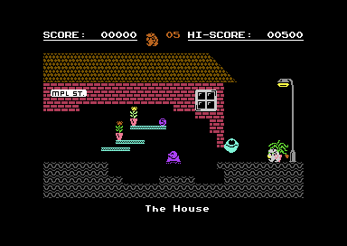

- Map row 2, column `$15`; neighbours on the grid: left `$01`.
- Tiles (library index, class, colour): `0A` wall 9, `0B` wall 9, `01` wall 2, `3A` one-way platform 3, `15` wall 11, `00` wall 0, `00` wall 0, `00` wall 0.
- Enemies: smiley (type 25, vertical, speed 2, range 37); skate (type 9, vertical, starts reversed, speed 3, range 19).
- Decorations: street lamp base, street lamp pole, street lamp pole, street lamp lamp, window, mpl st sign, yellow flower, yellow flower, sad flowers.

## Room $01

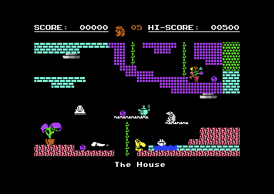

- Map row 2, column `$14`; neighbours on the grid: left `$02`, right `$00`, above `$09`, below `$0A`.
- Tiles (library index, class, colour): `02` wall 4, `63` rope 3, `01` wall 3, `0A` wall 5, `40` one-way platform 1, `05` wall 10, `55` hazard 6, `64` rope 5.
- Enemies: big nose (type 15, horizontal, speed 2, range 44); skate (type 9, vertical, speed 4, range 17); kettle (type 24, horizontal, speed 1, range 45).
- Decorations: purple flowers, bunch flower.
- Piledriver (column 7, row 5, 4 rows).
- Piledriver (column 31, row 12, 6 rows).
- Rising cloud platform (sprite 1).
- #19 cake.

## Room $02

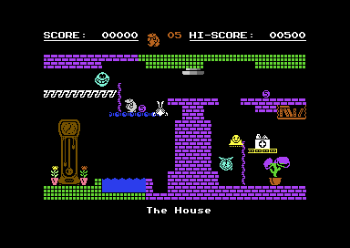

- Map row 2, column `$13`; neighbours on the grid: left `$03`, right `$01`, above `$08`, below `$0B`.
- Tiles (library index, class, colour): `02` wall 5, `01` wall 4, `27` one-way platform 7, `60` rope 4, `3D` one-way platform 6, `42` one-way platform 1, `77` empty 6, `55` hazard 6.
- Enemies: clock (type 14, vertical, speed 3, range 39); wasp (type 20, vertical, starts reversed, speed 2, range 60); skate (type 9, horizontal, speed 1, range 31); smiley (type 25, vertical, starts reversed, speed 4, range 14).
- Decorations: grandfather clock, books, yellow flower, yellow flower, purple flowers.
- Piledriver (column 21, row 5, 4 rows).
- #11 first aid kit.

## Room $03

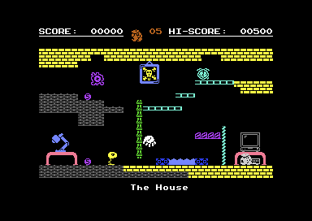

- Map row 2, column `$12`; neighbours on the grid: left `$04`, right `$02`, above `$07`, below `$0E`.
- Tiles (library index, class, colour): `01` wall 7, `2F` one-way platform 3, `00` wall 11, `65` rope 5, `5F` rope 3, `44` one-way platform 4, `11` wall 6, `55` hazard 14.
- Enemies: hand (type 27, vertical, starts reversed, speed 2, range 26); lamp (type 10, horizontal, starts reversed, speed 1, range 32); clock (type 14, horizontal, speed 2, range 72); jelly fish (type 29, vertical, speed 1, range 32).
- Decorations: coffee table, cassette player, cmb monitor, coffee table, desk lamp, picture frame, arrrrr.

## Room $04

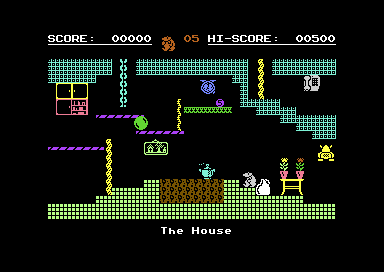

- Map row 2, column `$11`; neighbours on the grid: left `$05`, right `$03`, above `$06`, below `$0D`.
- Tiles (library index, class, colour): `03` wall 3, `62` rope 3, `3C` one-way platform 4, `60` rope 7, `43` one-way platform 5, `66` rope 7, `02` wall 13, `4F` hazard 9.
- Enemies: kettle (type 24, horizontal, speed 3, range 32); clock (type 14, vertical, speed 4, range 22); knight (type 11, vertical, speed 2, range 23); bubble (type 21, horizontal, starts reversed, speed 1, range 48).
- Decorations: yellow table, yellow flower, yellow flower, grey phone, cabinet, cabinet bookselh, first aid.
- #12 milk jug.

## Room $05

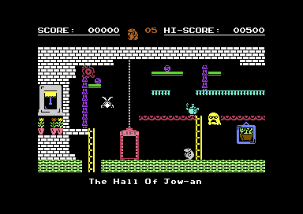

- Map row 2, column `$10`; neighbours on the grid: right `$04`, below `$0C`.
- Tiles (library index, class, colour): `01` wall 1, `41` one-way platform 5, `2B` one-way platform 3, `65` rope 4, `67` rope 7, `00` wall 13, `3F` one-way platform 2, `63` rope 3.
- Enemies: kettle (type 24, horizontal, speed 2, range 36); wasp (type 20, vertical, starts reversed, speed 3, range 32); jelly fish (type 29, horizontal, starts reversed, speed 1, range 32); sad ghost (type 22, vertical, starts reversed, speed 2, range 32).
- Decorations: another window, yellow flower, yellow flower, yellow flower, picture frame, green potplane.
- Lift, type 1: rides up then crushes you on the way back.

## Room $06

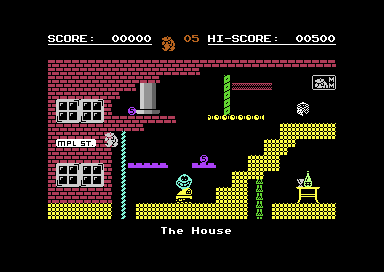

- Map row 1, column `$11`; neighbours on the grid: right `$07`, below `$04`.
- Tiles (library index, class, colour): `01` wall 2, `2D` one-way platform 4, `5F` rope 3, `3D` one-way platform 7, `61` rope 5, `3B` one-way platform 2, `24` wall 7, `65` rope 5.
- Enemies: tank (type 28, horizontal, speed 4, range 16); smiley (type 25, vertical, speed 3, range 38); rubik (type 17, vertical, speed 1, range 39).
- Decorations: yellow table, white goblet, portrait, green bottle, window, window, window, window, mpl st sign.
- Piledriver (column 13, row 6, 4 rows).

## Room $07

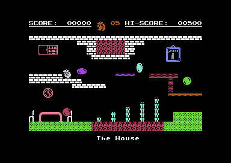

- Map row 1, column `$12`; neighbours on the grid: left `$06`, right `$08`, below `$03`.
- Tiles (library index, class, colour): `01` wall 1, `47` wall 3, `0C` wall 5, `3A` one-way platform 4, `3B` one-way platform 2, `39` one-way platform 8, `4F` hazard 2, `00` wall 0.
- Enemies: bubble (type 21, vertical, starts reversed, speed 2, range 23); bubble (type 21, vertical, speed 3, range 26); bubble (type 21, vertical, speed 1, range 39); bubble (type 21, vertical, speed 2, range 36).
- Decorations: coffee table, chair, chair, clock, picture frame, hammer, cabinet bookselh.

## Room $08

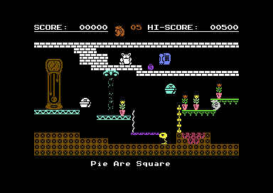

- Map row 1, column `$13`; neighbours on the grid: left `$07`, right `$09`, below `$02`.
- Tiles (library index, class, colour): `01` wall 1, `28` one-way platform 3, `1D` wall 9, `6A` rope 1, `40` one-way platform 4, `68` rope 7, `37` one-way platform 5, `4F` hazard 2.
- Enemies: lamp (type 10, horizontal, speed 2, range 39); pi pie (type 19, vertical, starts reversed, speed 2, range 39); pi pie (type 19, vertical, speed 3, range 29); bubble (type 21, horizontal, starts reversed, speed 2, range 128).
- Decorations: grandfather clock, grey phone, yellow flower, yellow flower, yellow flower, yellow flower.
- Teleporter to room `$06`.
- Taking the teddy bear wakes the bubble.
- #13 teddy bear.

## Room $09

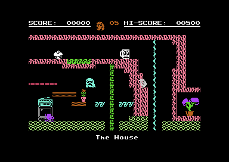

- Map row 1, column `$14`; neighbours on the grid: left `$08`, below `$01`.
- Tiles (library index, class, colour): `05` wall 10, `2C` one-way platform 2, `3B` one-way platform 8, `42` one-way platform 3, `65` rope 5, `60` rope 3, `15` wall 13, `4F` hazard 5.
- Enemies: sad mug (type 18, horizontal, speed 1, range 120); sad ghost (type 22, vertical, starts reversed, speed 2, range 35); boot (type 8, horizontal, starts reversed, speed 3, range 35).
- Decorations: cmb monitor, radio, yellow flower, purple flowers.
- #14 cupcake.

## Room $0A

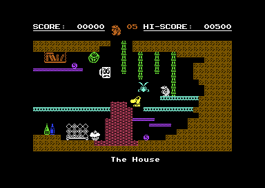

- Map row 3, column `$14`; neighbours on the grid: left `$0B`, above `$01`.
- Tiles (library index, class, colour): `0C` wall 9, `65` rope 5, `43` one-way platform 3, `3A` one-way platform 4, `00` wall 2, `00` wall 0, `00` wall 0, `00` wall 0.
- Enemies: wasp (type 20, vertical, speed 1, range 63); big nose (type 15, horizontal, starts reversed, speed 2, range 44); smiley (type 25, vertical, speed 3, range 21); sad mug (type 18, vertical, starts reversed, speed 2, range 32).
- Decorations: fire place, books, green bottle, blue bottle.
- #15 cupcake.

## Room $0B

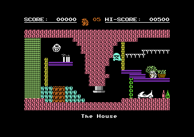

- Map row 3, column `$13`; neighbours on the grid: left `$0E`, right `$0A`, above `$02`.
- Tiles (library index, class, colour): `05` wall 10, `47` wall 3, `65` rope 7, `3B` one-way platform 4, `36` one-way platform 1, `62` rope 5, `03` wall 13, `51` hazard 8.
- Enemies: smiley (type 25, vertical, starts reversed, speed 1, range 31); sad ghost (type 22, vertical, starts reversed, speed 2, range 43).
- Decorations: blue bottle, green bottle, small bust, green potplane, the c5.
- Piledriver (column 19, row 17, 4 rows).
- #16 smoke stack.

## Room $0C

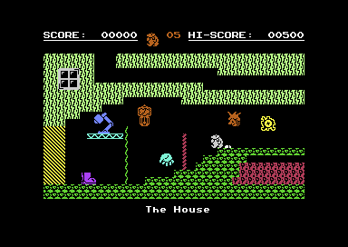

- Map row 3, column `$10`; neighbours on the grid: left `$0F`, right `$0D`, above `$05`, below `$11`.
- Tiles (library index, class, colour): `05` wall 13, `0F` wall 5, `10` wall 7, `28` one-way platform 3, `6A` rope 5, `5F` rope 2, `4F` hazard 2, `00` wall 0.
- Enemies: hand (type 27, vertical, starts reversed, speed 3, range 23); boot (type 8, horizontal, starts reversed, speed 2, range 35); jelly fish (type 29, vertical, starts reversed, speed 1, range 31); medusa (type 30, horizontal, speed 2, range 36).
- Decorations: window, cuckoo clock, desk lamp.
- Rising bollard (piledriver ride code, upwards).
- A block is cleared once the cupcake from room `$0D` is collected.

## Room $0D

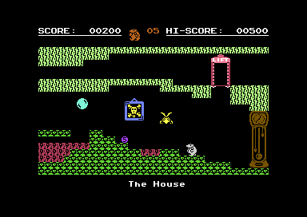

- Map row 3, column `$11`; neighbours on the grid: left `$0C`, right `$0E`, above `$04`.
- Tiles (library index, class, colour): `05` wall 13, `0F` wall 5, `4F` hazard 2, `19` wall 0, `00` wall 0, `00` wall 0, `00` wall 0, `00` wall 0.
- Enemies: bubble (type 21, vertical, starts reversed, speed 1, range 47); wasp (type 20, vertical, speed 2, range 27).
- Decorations: grandfather clock, picture frame, arrrrr.
- Lift, type 2: carries you down.
- #0 cupcake.

## Room $0E

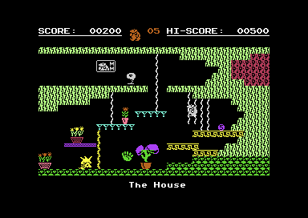

- Map row 3, column `$12`; neighbours on the grid: left `$0D`, right `$0B`, above `$03`.
- Tiles (library index, class, colour): `05` wall 13, `0F` wall 5, `6A` rope 1, `36` one-way platform 3, `60` rope 7, `3A` one-way platform 4, `26` wall 7, `4F` hazard 2.
- Enemies: medusa (type 30, horizontal, starts reversed, speed 4, range 33); lamp (type 10, horizontal, starts reversed, speed 2, range 58); hand (type 27, vertical, speed 2, range 39).
- Decorations: flowers, flowers, yellow flower, purple flowers, portrait.

## Room $0F

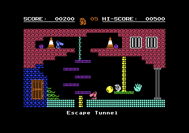

- Map row 3, column `$0F`; neighbours on the grid: right `$0C`, below `$10`.
- Tiles (library index, class, colour): `25` wall 2, `0F` wall 6, `02` wall 3, `64` rope 3, `27` one-way platform 4, `6B` rope 7, `31` one-way platform 5, `16` wall 5.
- Enemies: bubble (type 21, vertical, starts reversed, speed 3, range 23); hand (type 27, vertical, speed 2, range 35); big nose (type 15, horizontal, starts reversed, speed 2, range 71); big nose (type 15, horizontal, speed 1, range 156).
- Decorations: thing top, thing bottom, multi bar, multi bar, cell window, cell window, brown door, vlc, vlc.

## Room $10

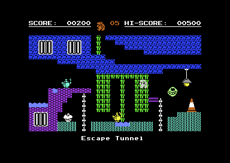

- Map row 4, column `$0F`; neighbours on the grid: right `$11`, above `$0F`, below `$12`.
- Tiles (library index, class, colour): `25` wall 6, `76` rope 5, `53` hazard 14, `1E` wall 3, `00` wall 4, `68` rope 1, `3B` one-way platform 4, `47` wall 5.
- Enemies: smiley (type 25, vertical, starts reversed, speed 2, range 30); kettle (type 24, horizontal, starts reversed, speed 1, range 38); kettle (type 24, horizontal, speed 2, range 79).
- Decorations: pendant lamp, vlc, cell window, cell window, cell window.
- #17 cupcake.

## Room $11

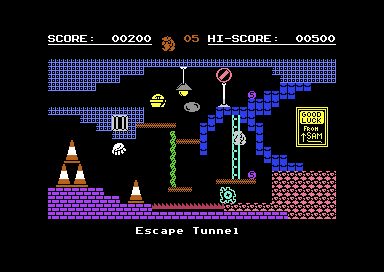

- Map row 4, column `$10`; neighbours on the grid: left `$10`, above `$0C`, below `$13`.
- Tiles (library index, class, colour): `03` wall 14, `13` wall 6, `0F` wall 10, `67` rope 3, `39` one-way platform 8, `01` wall 4, `66` rope 5, `54` hazard 2.
- Enemies: bubble (type 21, vertical, starts reversed, speed 2, range 27); pi pie (type 19, horizontal, starts reversed, speed 2, range 78); hand (type 27, vertical, starts reversed, speed 1, range 39); jelly fish (type 29, horizontal, starts reversed, speed 1, range 39).
- Decorations: vlc, vlc, vlc, vlc, pendant lamp, more bars, stop sign, good luck.

## Room $12

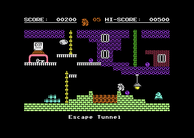

- Map row 5, column `$0F`; neighbours on the grid: left `$14`, right `$13`, above `$10`.
- Tiles (library index, class, colour): `15` wall 4, `1E` wall 2, `65` rope 5, `68` rope 7, `2B` one-way platform 1, `01` wall 13, `48` wall 3, `4F` hazard 8.
- Enemies: skate (type 9, vertical, speed 1, range 39); bubble (type 21, horizontal, starts reversed, speed 1, range 63).
- Decorations: more bars, more bars, more bars, exit computer, coffee table, key right, pendant lamp.

## Room $13

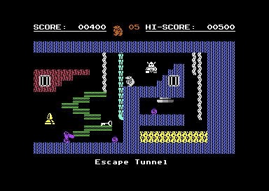

- Map row 5, column `$10`; neighbours on the grid: left `$12`, above `$11`.
- Tiles (library index, class, colour): `1E` wall 14, `05` wall 2, `66` rope 1, `3B` one-way platform 5, `76` rope 3, `73` rope 3, `4F` hazard 7, `00` wall 0.
- Enemies: cone (type 26, vertical, speed 2, range 29); big nose (type 15, horizontal, starts reversed, speed 2, range 39); knight (type 11, vertical, starts reversed, speed 1, range 31).
- Decorations: key left, more bars, more bars.
- Piledriver (column 24, row 13, 3 rows).
- #1 vase.

## Room $14

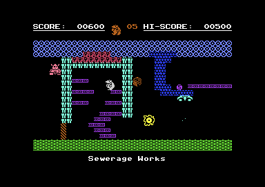

- Map row 5, column `$0E`; neighbours on the grid: left `$15`, right `$12`.
- Tiles (library index, class, colour): `0E` wall 14, `47` wall 3, `00` wall 5, `10` wall 8, `0A` wall 6, `27` one-way platform 4, `14` wall 10, `4F` hazard 2.
- Enemies: knight (type 11, vertical, speed 5, range 20); jelly fish (type 29, vertical, speed 2, range 51); rubik (type 17, vertical, starts reversed, speed 3, range 34).
- Teleporter to room `$13`.
- A wall is cleared by the vase (room `$13`); a second by the cupcake here, with the gas mask in the kit.
- #2 cupcake.

## Room $15

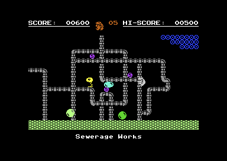

- Map row 5, column `$0D`; neighbours on the grid: left `$16`, right `$14`, above `$18`.
- Tiles (library index, class, colour): `00` wall 13, `6B` rope 12, `6C` rope 12, `0E` wall 6, `71` rope 12, `73` rope 12, `72` rope 12, `74` rope 12.
- Enemies: lamp (type 10, horizontal, speed 1, range 29); bubble (type 21, vertical, speed 1, range 31); bubble (type 21, horizontal, speed 2, range 33); bubble (type 21, vertical, starts reversed, speed 4, range 20).

## Room $16

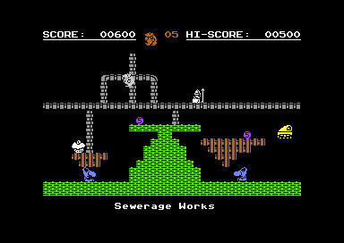

- Map row 5, column `$0C`; neighbours on the grid: left `$17`, right `$15`, above `$19`.
- Tiles (library index, class, colour): `00` wall 5, `6B` rope 12, `6C` rope 12, `09` wall 8, `72` rope 12, `71` rope 12, `00` wall 0, `00` wall 0.
- Enemies: big nose (type 15, horizontal, starts reversed, speed 2, range 31); big nose (type 15, horizontal, speed 2, range 31); king (type 16, horizontal, starts reversed, speed 2, range 31); tank (type 28, horizontal, speed 2, range 47).
- #4 cupcake.

## Room $17

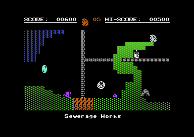

- Map row 5, column `$0B`; neighbours on the grid: left `$1C`, right `$16`, above `$1A`.
- Tiles (library index, class, colour): `00` wall 5, `1E` wall 6, `6B` rope 12, `6C` rope 12, `4F` hazard 8, `00` wall 0, `00` wall 0, `00` wall 0.
- Enemies: smiley (type 25, vertical, starts reversed, speed 3, range 18); boot (type 8, horizontal, starts reversed, speed 2, range 43); bubble (type 21, vertical, speed 2, range 31); skate (type 9, vertical, speed 4, range 14).
- #3 fly spray.

## Room $18

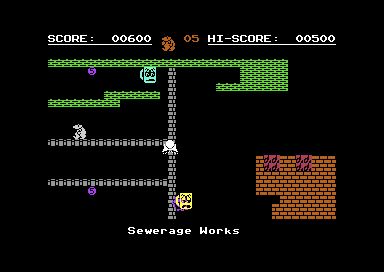

- Map row 4, column `$0D`; neighbours on the grid: left `$19`, below `$15`.
- Tiles (library index, class, colour): `00` wall 5, `6B` rope 12, `6C` rope 12, `01` wall 8, `51` hazard 2, `00` wall 0, `00` wall 0, `00` wall 0.
- Enemies: sad mug (type 18, vertical, speed 3, range 45); sad mug (type 18, horizontal, starts reversed, speed 2, range 63); skate (type 9, horizontal, starts reversed, speed 3, range 65); jelly fish (type 29, horizontal, starts reversed, speed 2, range 55).

## Room $19

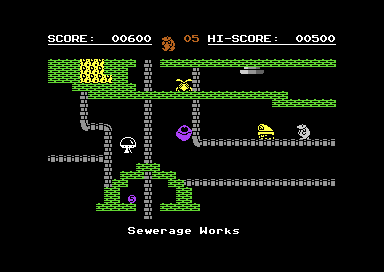

- Map row 4, column `$0C`; neighbours on the grid: left `$1A`, right `$18`, above `$1B`, below `$16`.
- Tiles (library index, class, colour): `00` wall 5, `6B` rope 12, `6C` rope 12, `73` rope 12, `71` rope 12, `4F` hazard 7, `00` wall 0, `00` wall 0.
- Enemies: tank (type 28, horizontal, speed 2, range 36); smiley (type 25, vertical, starts reversed, speed 2, range 31); ufo (type 12, vertical, starts reversed, speed 3, range 18); wasp (type 20, horizontal, speed 1, range 1).
- Piledriver (column 26, row 4, 3 rows).
- The wasp is removed by the fly spray (room `$17`).

## Room $1A

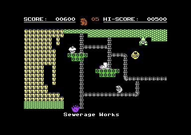

- Map row 4, column `$0B`; neighbours on the grid: right `$19`, below `$17`.
- Tiles (library index, class, colour): `00` wall 13, `47` wall 7, `6B` rope 12, `1D` wall 5, `6C` rope 12, `71` rope 12, `73` rope 12, `74` rope 12.
- Enemies: hand (type 27, vertical, speed 3, range 36); boot (type 8, horizontal, speed 1, range 39); smiley (type 25, vertical, starts reversed, speed 2, range 31); knight (type 11, vertical, speed 3, range 22).
- #6 cupcake.

## Room $1B

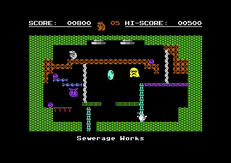

- Map row 3, column `$0C`; neighbours on the grid: below `$19`.
- Tiles (library index, class, colour): `00` wall 5, `11` wall 8, `3D` one-way platform 14, `66` rope 1, `31` one-way platform 4, `65` rope 3, `27` one-way platform 5, `36` one-way platform 2.
- Enemies: kettle (type 24, horizontal, speed 4, range 30); bubble (type 21, vertical, starts reversed, speed 2, range 39); sad ghost (type 22, vertical, starts reversed, speed 1, range 47); clock (type 14, horizontal, speed 1, range 71).
- Piledriver (column 15, row 4, 4 rows).
- Piledriver (column 21, row 4, 4 rows).
- #5 joystick.

## Room $1C

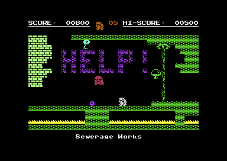

- Map row 5, column `$0A`; neighbours on the grid: left `$1D`, right `$17`.
- Tiles (library index, class, colour): `01` wall 13, `00` wall 5, `32` one-way platform 4, `54` hazard 7, `00` wall 13, `00` wall 0, `00` wall 0, `00` wall 0.
- Enemies: lamp (type 10, horizontal, starts reversed, speed 6, range 14); ufo (type 12, vertical, starts reversed, speed 2, range 31); sad ghost (type 22, vertical, starts reversed, speed 1, range 39).
- Teleporter to room `$1B`.
- A gap in the floor until the joystick (room `$1B`) is collected.

## Room $1D

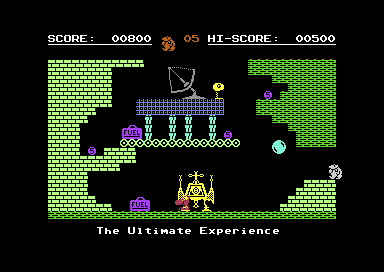

- Map row 5, column `$09`; neighbours on the grid: right `$1C`, above `$1E`.
- Tiles (library index, class, colour): `01` wall 13, `00` wall 5, `0E` wall 13, `03` wall 14, `47` wall 3, `00` wall 0, `00` wall 0, `00` wall 0.
- Enemies: big nose (type 15, horizontal, starts reversed, speed 2, range 42); lamp (type 10, horizontal, speed 2, range 67); bubble (type 21, vertical, speed 2, range 25).
- Decorations: fuel, satelite 1, fuel, lander.
- Jetpack, if the jet pack is in the Freedom Kit.

## Room $1E

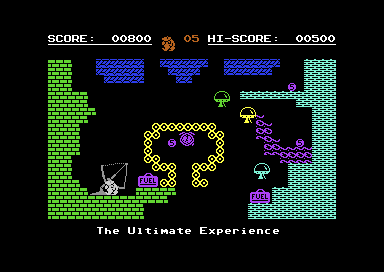

- Map row 4, column `$09`; neighbours on the grid: above `$1F`, below `$1D`.
- Tiles (library index, class, colour): `01` wall 5, `1F` wall 6, `00` wall 3, `16` wall 4, `0E` wall 7, `00` wall 0, `00` wall 0, `00` wall 0.
- Enemies: clock (type 14, horizontal, speed 1, range 31); ufo (type 12, horizontal, speed 2, range 31); ufo (type 12, horizontal, speed 3, range 45); ufo (type 12, vertical, speed 2, range 19).
- Decorations: satelite 2, fuel, fuel.
- Jetpack, if the jet pack is in the Freedom Kit.

## Room $1F

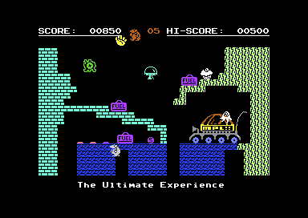

- Map row 3, column `$09`; neighbours on the grid: above `$20`, below `$1E`.
- Tiles (library index, class, colour): `01` wall 3, `1F` wall 6, `05` wall 13, `00` wall 0, `00` wall 0, `00` wall 0, `00` wall 0, `00` wall 0.
- Enemies: alien (type 23, horizontal, speed 2, range 49); hand (type 27, vertical, starts reversed, speed 2, range 53); jelly fish (type 29, vertical, starts reversed, speed 1, range 46); ufo (type 12, horizontal, starts reversed, speed 2, range 34).
- Decorations: mpl buggy, fuel, fuel, fuel.
- Jetpack, if the jet pack is in the Freedom Kit.
- #7 cupcake.

## Room $20

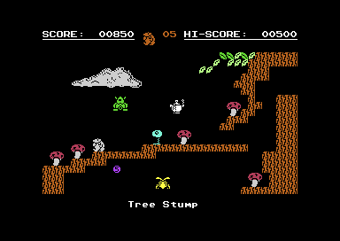

- Map row 2, column `$09`; neighbours on the grid: left `$24`, right `$21`, below `$1F`.
- Tiles (library index, class, colour): `05` wall 8, `33` one-way platform 13, `2A` one-way platform 5, `00` wall 0, `00` wall 0, `00` wall 0, `00` wall 0, `00` wall 0.
- Enemies: wasp (type 20, vertical, speed 1, range 34); lamp (type 10, horizontal, starts reversed, speed 3, range 48); knight (type 11, vertical, starts reversed, speed 2, range 33); kettle (type 24, vertical, starts reversed, speed 1, range 31).
- Decorations: the cloud, mushroom, mushroom, mushroom, mushroom, mushroom.
- Jetpack, if the jet pack is in the Freedom Kit.

## Room $21

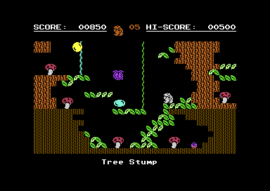

- Map row 2, column `$0A`; neighbours on the grid: left `$20`, above `$22`.
- Tiles (library index, class, colour): `1E` wall 9, `05` wall 8, `2A` one-way platform 5, `33` one-way platform 13, `60` rope 3, `6A` rope 5, `00` wall 0, `00` wall 0.
- Enemies: clock (type 14, vertical, starts reversed, speed 2, range 31); bubble (type 21, horizontal, starts reversed, speed 1, range 55); bubble (type 21, horizontal, speed 2, range 47); pi pie (type 19, vertical, starts reversed, speed 2, range 47).
- Decorations: mushroom, mushroom, mushroom, mushroom, mushroom.

## Room $22

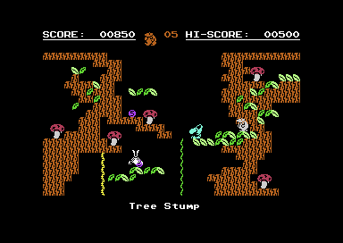

- Map row 1, column `$0A`; neighbours on the grid: above `$23`, below `$21`.
- Tiles (library index, class, colour): `05` wall 8, `2A` one-way platform 13, `33` one-way platform 5, `6A` rope 5, `60` rope 7, `64` rope 3, `00` wall 0, `00` wall 0.
- Enemies: wasp (type 20, vertical, starts reversed, speed 1, range 23); big nose (type 15, horizontal, speed 1, range 31); clock (type 14, vertical, starts reversed, speed 3, range 47).
- Decorations: mushroom, mushroom, mushroom, mushroom, mushroom.
- The rope to the top exit is only there with the rope in the Freedom Kit.

## Room $23

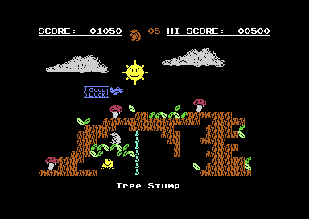

- Map row 0, column `$0A`; neighbours on the grid: below `$22`.
- Tiles (library index, class, colour): `05` wall 8, `2A` one-way platform 13, `33` one-way platform 5, `64` rope 3, `00` wall 0, `00` wall 0, `00` wall 0, `00` wall 0.
- Enemies: flying banner 1 (type 32, horizontal, speed 1, range 208); flying banner 2 (type 33, horizontal, speed 1, range 208); flying banner 3 (type 34, horizontal, speed 1, range 208); skate (type 9, horizontal, speed 2, range 15).
- Decorations: the cloud, sun, the cloud, mushroom, mushroom, mushroom.
- #8 jerry can.

## Room $24

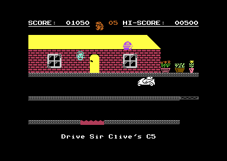

- Map row 2, column `$08`; neighbours on the grid: left `$25`, right `$20`.
- Tiles (library index, class, colour): `5B` rope 12, `53` hazard 2, `01` wall 2, `57` rope 7, `4E` hazard 7, `58` rope 7, `59` rope 7, `5A` rope 7.
- Enemies: queen liz (type 13, vertical, starts reversed, speed 1, range 32); pi pie (type 19, vertical, speed 2, range 24).
- Decorations: window, window, flowers, green potplane, yellow flower.
- C5 drive room (zp_c5_drive_active).

## Room $25

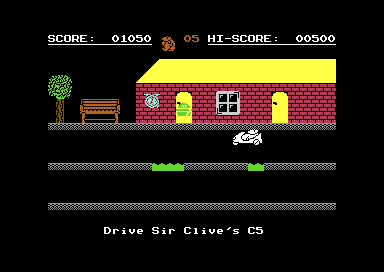

- Map row 2, column `$07`; neighbours on the grid: left `$31`, right `$24`.
- Tiles (library index, class, colour): `5B` rope 12, `53` hazard 5, `01` wall 2, `4B` wall 7, `4E` hazard 7, `58` rope 7, `59` rope 7, `5A` rope 7.
- Enemies: clock (type 14, vertical, starts reversed, speed 1, range 24); pi pie (type 19, vertical, starts reversed, speed 2, range 19).
- Decorations: green bush, brown, bench, window.
- C5 drive room (zp_c5_drive_active).

## Room $26

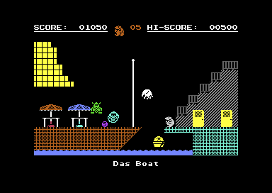

- Map row 2, column `$03`; neighbours on the grid: left `$27`, right `$33`, below `$29`.
- Tiles (library index, class, colour): `03` wall 3, `03` wall 8, `08` wall 12, `49` wall 1, `4A` wall 1, `55` hazard 14, `1B` wall 7, `6E` rope 8.
- Enemies: hand (type 27, vertical, starts reversed, speed 3, range 33); pi pie (type 19, vertical, starts reversed, speed 1, range 23); smiley (type 25, vertical, starts reversed, speed 2, range 23); knight (type 11, vertical, starts reversed, speed 1, range 31).
- Decorations: orange umbrella, orange umbrella, rad 1, rad 2, rad 1, rad 2, rad 1, rad 2, rad 1, rad 2, rad 2, rad 1, door, door.
- Tile slots 4 and 5 are made non-solid on entry.

## Room $27

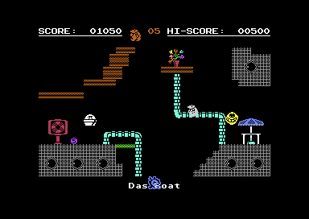

- Map row 2, column `$02`; neighbours on the grid: left `$2C`, right `$26`, above `$2E`, below `$28`.
- Tiles (library index, class, colour): `03` wall 12, `6B` rope 3, `6C` rope 3, `71` rope 3, `72` rope 3, `39` one-way platform 5, `73` rope 3, `3B` one-way platform 8.
- Enemies: jelly fish (type 29, vertical, speed 4, range 37); pi pie (type 19, vertical, starts reversed, speed 2, range 15); smiley (type 25, vertical, speed 2, range 31).
- Decorations: orange umbrella, life preserver, bunch flower, vortex, vortex, vortex, vortex, vortex, vortex.

## Room $28

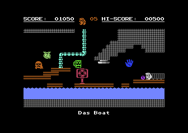

- Map row 3, column `$02`; neighbours on the grid: left `$2A`, right `$29`, above `$27`.
- Tiles (library index, class, colour): `03` wall 12, `3B` one-way platform 8, `6B` rope 3, `6C` rope 3, `72` rope 3, `74` rope 3, `53` hazard 14, `77` empty 14.
- Enemies: hand (type 27, vertical, speed 2, range 27); clock (type 14, vertical, speed 2, range 31); sad ghost (type 22, vertical, speed 1, range 47); sad mug (type 18, horizontal, speed 2, range 27).
- Decorations: rad 1, rad 1, rad 2, life preserver.
- Piledriver (column 21, row 11, 6 rows).

## Room $29

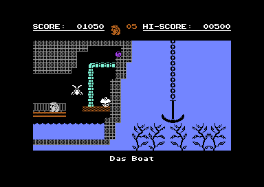

- Map row 3, column `$03`; neighbours on the grid: left `$28`, above `$26`.
- Tiles (library index, class, colour): `77` empty 14, `03` wall 12, `3B` one-way platform 8, `6B` rope 3, `6C` rope 3, `72` rope 3, `55` hazard 14, `5C` rope 14.
- Enemies: wasp (type 20, vertical, starts reversed, speed 1, range 63).
- Decorations: anchor, art 1, art 1, art 2, art 2, art 1, rad 1, rad 1, rad 1.
- #9 cupcake.

## Room $2A

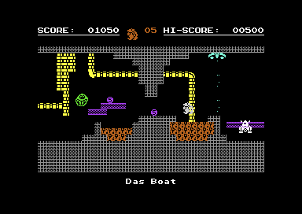

- Map row 3, column `$01`; neighbours on the grid: left `$2B`, right `$28`, above `$2C`.
- Tiles (library index, class, colour): `03` wall 12, `6B` rope 7, `6C` rope 7, `3B` one-way platform 4, `73` rope 7, `71` rope 7, `4F` hazard 8, `00` wall 0.
- Enemies: knight (type 11, vertical, speed 2, range 47); smiley (type 25, vertical, starts reversed, speed 2, range 31).
- Teleporter to room `$29`.

## Room $2B

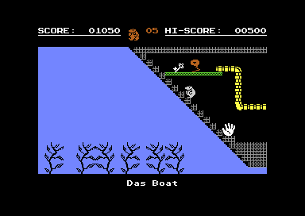

- Map row 3, column `$00`; neighbours on the grid: right `$2A`, above `$2D`.
- Tiles (library index, class, colour): `29` one-way platform 14, `03` wall 12, `3A` one-way platform 5, `6C` rope 7, `6B` rope 7, `73` rope 7, `71` rope 7, `77` empty 14.
- Enemies: hand (type 27, vertical, starts reversed, speed 3, range 21); lamp (type 10, horizontal, speed 2, range 31).
- Decorations: art 1, art 1, art 2, art 1, art 2, art 2.
- #10 key.

## Room $2C

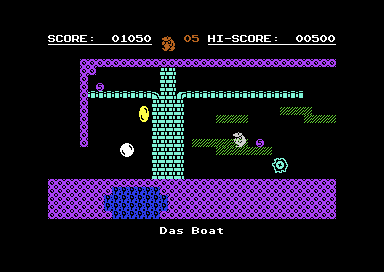

- Map row 2, column `$01`; neighbours on the grid: left `$2D`, right `$27`, above `$2F`, below `$2A`.
- Tiles (library index, class, colour): `04` wall 4, `6C` rope 3, `6B` rope 3, `35` one-way platform 5, `71` rope 3, `72` rope 3, `4F` hazard 6, `00` wall 0.
- Enemies: bubble (type 21, vertical, starts reversed, speed 3, range 31); bubble (type 21, vertical, speed 1, range 23); jelly fish (type 29, vertical, starts reversed, speed 2, range 23).

## Room $2D

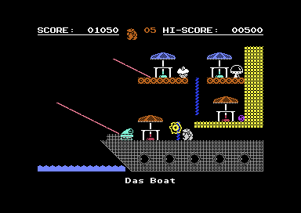

- Map row 2, column `$00`; neighbours on the grid: right `$2C`, below `$2B`.
- Tiles (library index, class, colour): `03` wall 12, `78` empty 12, `55` hazard 14, `5D` rope 10, `5E` rope 10, `5F` rope 6, `24` wall 7, `04` wall 8.
- Enemies: ufo (type 12, horizontal, speed 1, range 1); jelly fish (type 29, vertical, starts reversed, speed 2, range 23); tank (type 28, horizontal, speed 2, range 55).
- Decorations: orange umbrella, orange umbrella, orange umbrella, vortex, vortex, vortex, vortex, vortex, orange umbrella.
- Tile slots 4 and 5 are made non-solid on entry.
- #18 cupcake.

## Room $2E

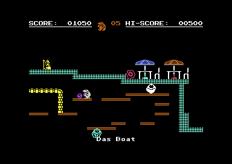

- Map row 1, column `$02`; neighbours on the grid: left `$2F`, below `$27`.
- Tiles (library index, class, colour): `03` wall 3, `3A` one-way platform 8, `6B` rope 7, `6C` rope 7, `71` rope 7, `00` wall 0, `00` wall 0, `00` wall 0.
- Enemies: smiley (type 25, vertical, speed 2, range 47); smiley (type 25, horizontal, speed 1, range 63); king (type 16, horizontal, speed 1, range 25); jelly fish (type 29, horizontal, speed 1, range 1).
- Decorations: orange umbrella, chair, orange umbrella, chair.

## Room $2F

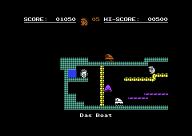

- Map row 1, column `$01`; neighbours on the grid: right `$2E`, below `$2C`.
- Tiles (library index, class, colour): `03` wall 3, `3C` one-way platform 4, `6B` rope 7, `72` rope 7, `74` rope 7, `6C` rope 7, `00` wall 0, `00` wall 0.
- Enemies: tank (type 28, horizontal, speed 1, range 39); tank (type 28, horizontal, speed 2, range 23); skate (type 9, vertical, speed 2, range 31); queen liz (type 13, horizontal, speed 1, range 1).
- Treasure (after the jerry can) and Queen Liz.
- Queen Liz is removed by the key (room `$2B`) with the barrel of rum in the kit.

## Room $30

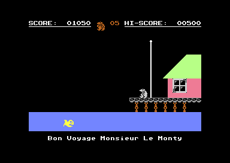

- Tiles (library index, class, colour): `4D` wall 12, `4E` hazard 10, `4C` wall 8, `4E` hazard 14, `4B` wall 13, `4E` hazard 13, `49` wall 1, `4A` wall 1.
- Enemies: fish (type 31, horizontal, speed 1, range 255).
- Decorations: window.
- Bon Voyage: the ending, loaded by FreedomSequence.
- The ending as played, with and without the passport: [GAMEPLAY.md](GAMEPLAY.md#the-ending).

## Room $31

- Map row 2, column `$06`; neighbours on the grid: left `$32`, right `$25`.
- Tiles (library index, class, colour): `5B` rope 12, `54` hazard 10, `00` wall 0, `00` wall 0, `00` wall 0, `00` wall 0, `00` wall 0, `00` wall 0.
- Enemies: sad mug (type 18, vertical, starts reversed, speed 1, range 40).
- Decorations: green bush, brown, green bush, brown, green bush, brown, bench, warn, green bush, brown, green bush, brown, speed limit, bar3, bar4, green bush, brown.
- C5 drive room (zp_c5_drive_active).
- One of the three last road screens before the boat, numbered after the ending: see [VERIFICATION.md](VERIFICATION.md#the-late-c5-rooms).

## Room $32

- Map row 2, column `$05`; neighbours on the grid: left `$33`, right `$31`.
- Tiles (library index, class, colour): `5B` rope 12, `55` hazard 4, `00` wall 0, `00` wall 0, `00` wall 0, `00` wall 0, `00` wall 0, `00` wall 0.
- Enemies: bubble (type 21, vertical, speed 2, range 19).
- Decorations: green bush, brown, bench, warn, bench, park, green bush, brown, green bush, brown, green bush, brown, bench, warn.
- C5 drive room (zp_c5_drive_active).
- One of the three last road screens before the boat, numbered after the ending: see [VERIFICATION.md](VERIFICATION.md#the-late-c5-rooms).

## Room $33

- Map row 2, column `$04`; neighbours on the grid: left `$26`, right `$32`.
- Tiles (library index, class, colour): `5B` rope 12, `56` rope 7, `00` wall 0, `00` wall 0, `00` wall 0, `00` wall 0, `00` wall 0, `00` wall 0.
- Enemies: hand (type 27, vertical, speed 2, range 24); wasp (type 20, vertical, starts reversed, speed 1, range 48).
- Decorations: rad 1, rad 1, rad 1, rad 1, brown, green bush, rad 1, rad 1, rad 2, bench, green bush, brown, rad 1, rad 1, rad 1, rad 1, rad 1, rad 2, park.
- C5 drive room (zp_c5_drive_active).
- One of the three last road screens before the boat, numbered after the ending: see [VERIFICATION.md](VERIFICATION.md#the-late-c5-rooms).
