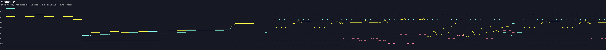

# Monty on the Run – Sound

Rob Hubbard's music driver, the three songs, the sound-effect engine bolted on after it, and how to play the soundtrack
outside the game. The decoded tracks, patterns, instruments and effects are generated into
[SOUND_DATA.md](SOUND_DATA.md) by `tools/extract_sound.py`.

---

## Listening

The recordings below are the game's own driver and data, played by VICE's SID player (reSID, MOS 6581, PAL) from
`build/monty_on_the_run.sid`.

| Song | Used for                                                | Length               | Recording                   |
| :--- | :------------------------------------------------------ | :------------------- | :-------------------------- |
| 0    | The main theme: title screen, and in-game in music mode | 5:51 before it loops |  |
| 1    | Game over                                               | 12.4 s as played     |  |
| 2    | Hi-score name entry, and the ending                     | 2:44 (longest voice) |  |

Song 0 is the famous one, built on Charles Williams's *Devil's Galop* (the *Dick Barton* radio theme). In the game it
starts on the title screen and carries on into play; nothing restarts it when a game begins.

---

## The Driver (`$8012–$837C`)

`MusicPlay` is called once per frame, from the game interrupt (`MainGameLoop`) or the title's line-251 interrupt. It
sets the volume to 15, then advances each of the three voices.

| Address | Label             | Role                                                        |
| :------ | :---------------- | :---------------------------------------------------------- |
| `$8012` | `MusicPlay`       | Once per frame: music, then the effect engine               |
| `$9554` | `MusicInit`       | A = song 0–2: load the three track pointers, silence, start |
| `$957D` | `MusicStop`       | `music_status` = `$C0`: silence the voices on the next call |
| `$9583` | `ClearSFXTrigger` | Cancel a queued effect                                      |
| `$9591` | `MusicPlaySFX`    | A = effect `$00–$0F`: start it on the next frame            |

The driver keeps its state in `$84C0–$8505` and uses only four zero-page bytes (`$02–$05`, the track and pattern
pointers), so it is self-contained: `$8000–$95FF` is a complete player. `music_status` bit 7 means off, bit 6 means
"start the song on the next call".

### Tempo

`music_tick_rate` is 1: each voice advances every second frame, 25 ticks a second on a PAL machine. A note's length byte
counts ticks.

### Songs and Tracks

`music_song_ptrs` (`$856C`) has 6 bytes per song: the low bytes of the three voices' track addresses, then the high
bytes. A track is a list of pattern numbers, ended by `$FF` (loop to the start) or `$FE` (stop). `music_currtrkhi/lo`
hold the current track pointers (despite the names, `currtrkhi` holds the low bytes).

### Patterns

`music_pat_ptrs_lo/hi` (`$857E`, `$85CB`) point at 77 patterns. A pattern is a list of notes ended by `$FF`:

| Byte(s)                | Meaning                                                                    |
| :--------------------- | :------------------------------------------------------------------------- |
| length byte            | Bits 0–4: length − 1 in ticks. Bit 6: append. Bit 7: an extra byte follows |
| extra byte (bit 7 set) | Bit 7 set: a portamento value. Clear: a new instrument number              |
| note byte              | Note number 0–95 into the frequency table (not present for an append)      |

An **append** note is one byte. It keeps the previous pitch and rewrites the control register with the gate bit cleared,
so the note goes into its release. The frequency table (`$8400`) holds 96 notes as interleaved low/high pairs, C-0 to
B-7.

### Instruments (`music_instr_tbl`, `$93B4`)

20 records of 8 bytes: pulse width (low, high), control register (waveform), attack/decay, sustain/release, vibrato
depth, pulse speed and effect flags. The effect bits are:

| Bit | Routine         | Effect                                               |
| :-- | :-------------- | :--------------------------------------------------- |
| 0   | `music_drums`   | Drum: noise on the first frame, then a falling pitch |
| 1   | `music_skydive` | Slow downward pitch slide                            |
| 2   | `music_octarp`  | Octave arpeggio (alternate frames an octave up)      |

Vibrato (`music_vibrato`), pulse-width modulation (`music_pulsework`) and portamento (`music_portamento`) run every
frame between note changes.

### The `$FE` Stop Command

In Hubbard's driver a `$FE` track entry simply jumps to the end of the play routine. Here it first calls `$8003`: the
high byte of the CBM80 warm-start vector, followed by the `CBM80` signature, run as code. That is `ADC ($C3),Y`, an
illegal two-byte `NOP`, `SEC`, then `BMI $8056` (into the middle of the driver) or, if not taken, another illegal `NOP`
and a `BRK`. Whatever it was for, it is unreachable in play. Only song 1 (game over) ends in `$FE`, and the game leaves
for the title, which restarts the music, 12.4 s after the game-over sequence begins, before the jingle reaches its end
at 13.3 s (both measured in VICE). The refactored build removes the call.

A SID player does reach it. Played for longer than 13.3 s, subtune 2 of the `.sid` runs those bytes and the voices keep
sounding instead of stopping. The recording above is cut at 12.4 s, as the game plays it.

---

## Sound Effects (`$837D–$8565`)

The effect engine runs at the end of every `MusicPlay` call. `MusicPlaySFX` stores the effect number with bit 6 set in
`sfx_id`. On the next frame `InitSFXVoices` copies the 16-byte record from `sfx_tbl` (`$9454`) into voices 1 and 2 and
patches the sweep instruction (`sfx_sweep_step`) to `INC` or `DEC`. From then on the engine steps a note number from the
start value to the end value, one step every *rate* + 1 frames, and writes the matching frequencies to voices 1 and 2.

| Byte | Meaning                                                                                                                                                              |
| :--- | :------------------------------------------------------------------------------------------------------------------------------------------------------------------- |
| 0    | Bits 0–3: rate. Bits 4–5: `%10` sweeps up, otherwise down. Bit 6: voice 2 only. Bit 7: no frequency writes                                                           |
| 1–7  | Voice 1 registers `$D400–$D406` (byte 1 is also the start note)                                                                                                      |
| 8–14 | Voice 2 registers `$D407–$D40D`. Byte 8 also sets the sweep: bits 0–5 are voice 2's interval below voice 1, bit 7 toggles voice 1's gate every step, bit 6 voice 2's |
| 15   | End note                                                                                                                                                             |

While an effect runs, the driver stops writing the music to voices 1 and 2 (`sfx_note_suppress`), and voice 3 carries on
with the tune. `sfx_trigger_latch` can hold an effect so that it wins over later requests (no code sets it; the dead
bytes at `$9589` once did).

Of the 16 records, 13 are used. Three (jump, jetpack thrust, piledriver start) are only requested in sound-effect mode;
the others play in both modes. The table in [SOUND_DATA.md](SOUND_DATA.md) lists every trigger, and the clips are below:

| Effect | Trigger                        | Clip                        |
| :----- | :----------------------------- | :-------------------------- |
| `$00`  | Teleporter                     |  |
| `$01`  | Jump (sound-effect mode)       |  |
| `$02`  | Piledriver (sound-effect mode) |  |
| `$03`  | Jetpack (sound-effect mode)    |  |
| `$04`  | Boarding the squash lift       |  |
| `$05`  | Lift moving, piledriver ride   |  |
| `$07`  | Coin                           |  |
| `$08`  | Special item                   |  |
| `$09`  | Death: four pieces             |  |
| `$0A`  | Death: enemy                   |  |
| `$0C`  | Death: piledriver base         |  |
| `$0D`  | Death: water or lava           |  |
| `$0E`  | Death: lift squash, C5 crash   |  |

---

## A Leftover Test Harness (`$95A0–$95F9`)

The 90 bytes after the music API are never called and carry no label in the source, but they disassemble cleanly into
four routines:

| Address | Code                                                                                                         |
| :------ | :----------------------------------------------------------------------------------------------------------- |
| `$95A0` | `SEI`, point the KERNAL IRQ vector `$0314` at `$95B7`, stop CIA1 timer A, enable the raster interrupt, `CLI` |
| `$95B7` | Interrupt: acknowledge, raster line `$80`, `$D011` = `$1B`, `JSR $8012`, `JMP $EA31`                         |
| `$95CC` | Restore `$0314` to `$EA31`, restart the timer, disable the raster interrupt                                  |
| `$95E3` | `SEI`, `STX $D016`, KERNAL `IOINIT`, `RAMTAS`, `RESTOR`, `CINT`, `$E453`, `CLI`, `JMP $7200`                 |

The first three are a stand-alone player for trying the music from BASIC under the KERNAL; the fourth resets the KERNAL
and jumps to `$7200`. They are development leftovers, like the tape-loader stub at `$3E23`. `extract_sound.py` puts its
init stub over them in the `.sid`.

---

## Playing the Soundtrack Outside VICE

`just sound` writes `build/monty_on_the_run.sid`, a PSID v2 file:

| Subtunes | Content           |
| :------- | :---------------- |
| 1–3      | Songs 0, 1, 2     |
| 4–19     | Effects `$00–$0F` |

It holds `$8000–$95FF` unchanged, with a 21-byte init stub at `$95A0`. The stub calls `MusicInit` for songs; for effects
it calls `MusicStop`, `ClearSFXTrigger` and `MusicPlaySFX`. The play address is `MusicPlay`. `just play` plays it in
VICE's `vsid` (`just play tune=3` for song 2), and any PSID player (sidplayfp, JSIDPlay2, DeepSID) can play the file.
`just sound-audio` re-records the clips above (about six minutes, in real time).
