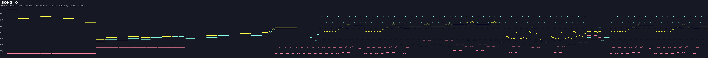
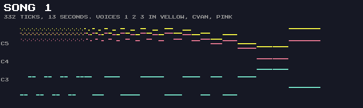
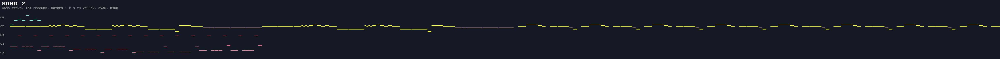

# Monty on the Run – Sound Data

Generated by `tools/extract_sound.py` from `build/motr.prg`: do not edit by hand. The formats are explained in [SOUND.md](SOUND.md).

---

## Songs

Notes advance every 2 frames (`music_tick_rate` = 1), 25 ticks per second on a PAL machine.

| Song | Used for                                             | Voice | Track   | Patterns | End   | Ticks | Seconds |
| :--- | :--------------------------------------------------- | :---- | :------ | :------- | :---- | ----: | ------: |
| 0    | Main theme: title screen, and in-game in music mode  | 1     | `$8618` | 64       | `$FF` | 8768  | 350.7   |
|      |                                                      | 2     | `$8659` | 75       | `$FF` | 8768  | 350.7   |
|      |                                                      | 3     | `$86A5` | 131      | `$FF` | 8768  | 350.7   |
| 1    | Game over                                            | 1     | `$8761` | 6        | `$FE` | 332   | 13.3    |
|      |                                                      | 2     | `$8768` | 4        | `$FE` | 332   | 13.3    |
|      |                                                      | 3     | `$876D` | 6        | `$FE` | 332   | 13.3    |
| 2    | Hi-score entry and the freedom (completion) sequence | 1     | `$8729` | 44       | `$FF` | 4096  | 163.8   |
|      |                                                      | 2     | `$8756` | 1        | `$FF` | 64    | 2.6     |
|      |                                                      | 3     | `$8758` | 8        | `$FF` | 512   | 20.5    |


### Track Orders

- Song 0, voice 1: 11 14 17 1A 00 27 00 28 03 05 00 27 00 28 03 05 07 3A 14 17 00 27 00 28 2F 30 31 31 32 33 33 34 34 34 34 34 34 34 34 35 35 35 35 35 35 36 12 37 38 09 2A 09 2B 09 0A 09 2A 09 2B 09 0A 0D 0D 0F
- Song 0, voice 2: 12 15 18 1B 2D 39 39 39 39 39 39 2C 39 39 39 39 39 39 2C 39 39 39 01 01 29 29 2C 15 18 39 39 39 39 39 39 39 39 39 39 39 39 39 39 39 39 39 39 39 39 39 39 39 39 39 39 39 39 39 39 39 01 01 01 29 39 39 39 01 01 01 29 39 39 39 39
- Song 0, voice 3: 13 16 19 1C 02 02 1D 1E 02 02 1D 1F 04 04 20 20 06 02 02 1D 1E 02 02 1D 1F 04 04 20 20 06 08 08 08 08 21 21 21 21 22 22 22 23 22 24 25 3B 26 26 26 26 26 26 26 26 26 26 26 26 26 26 26 26 02 02 1D 1E 02 02 1D 1F 2F 2F 2F 2F 2F 2F 2F 2F 2F 2F 2F 2F 2F 0B 0B 1D 1D 0B 0B 1D 0B 0B 0B 0C 0C 1D 1D 1D 10 0B 0B 1D 1D 0B 0B 1D 0B 0B 0B 0C 0C 1D 1D 1D 10 0B 1D 0B 1D 0B 1D 0B 1D 0B 0C 1D 0B 0C 23 0B 0B

- Song 1, voice 1: 3C 3C 3C 3C 3E 2E
- Song 1, voice 2: 0B 0B 40 2E
- Song 1, voice 3: 3D 3D 3D 3D 3F 2E

- Song 2, voice 1: 46 47 48 46 47 48 49 49 49 49 49 49 49 49 4B 4B 4B 4B 4B 4B 4C 4A 4A 4A 4A 4A 4A 4A 4A 4A 4A 4A 4A 4A 4A 4A 4A 4B 4B 4B 4B 4B 4B 4C
- Song 2, voice 2: 41
- Song 2, voice 3: 42 42 43 43 44 44 45 45







---

## Patterns

Each event: length in ticks, then the note (`-` = append: pitch held, gate off), with `iNN` for an instrument change or `pNN` for a portamento byte.

77 pattern pointers; 76 patterns used by the three songs (0E unused).

- **00** `$8774` (96 ticks): 4:G-4 i00, 2:D-5, 2:D-5, 4:C#5, 4:D-5, 4:G-5, 4:D-5, 4:C#5, 4:D-5, 4:G-4, 2:D-5, 2:D-5, 4:C#5, 4:D-5, 4:G-5, 4:F#5, 4:G-5, 4:A-5, 4:A#5, 2:C-6, 2:A#5, 4:A-5, 4:G-5, 4:D#6, 2:F-6, 2:D#6, 4:D-6, 4:C-6
- **01** `$8DA2` (32 ticks): 4:G-5 i01, 2:G-6, 2:G-7, 8:B-3 i03, 4:G-5 i01, 2:G-6, 2:G-7, 8:B-3 i03
- **02** `$8DB7` (32 ticks): 4:G-1 i02, 4:G-1, 4:G-2, 4:G-2, 4:G-1, 4:G-1, 4:G-2, 4:G-2
- **03** `$87BE` (256 ticks): 32:C-6 i06, 8:C-6, 2:D#6, 2:D-6, 2:D#6, 2:D-6, 4:D#6, 4:F-6, 4:D#6, 4:D-6, 32:C-6, 8:C-6, 2:D#6, 2:D-6, 2:D#6, 2:D-6, 4:D#6, 4:F-6, 4:D#6, 4:C-6, 32:E-6, 8:E-6, 2:G-6, 2:F#6, 2:G-6, 2:F#6, 4:G-6, 4:A-6, 4:G-6, 4:F#6, 32:E-6, 8:E-6, 2:G-6, 2:F#6, 2:G-6, 2:F#6, 4:G-6, 4:A-6, 4:G-6, 4:E-6
- **04** `$8DFA` (64 ticks): 4:C-2, 4:C-2, 4:C-3, 4:C-3, 4:C-2, 4:C-2, 4:C-3, 4:C-3, 4:G#2, 4:G#2, 4:G#3, 4:G#3, 4:G#2, 4:G#2, 4:G#3, 4:G#3
- **05** `$8810` (320 ticks): 4:D-3 i04, 4:F-3, 4:E-3, 4:F-3, 4:D-3, 4:F-4, 4:E-4, 4:D-4, 4:A-3, 4:C-4, 4:B-3, 4:C-4, 4:A-3, 4:C-5, 4:B-4, 4:A-4, 4:C-4, 4:D#4, 4:D-4, 4:D#4, 4:C-4, 4:D#5, 4:D-5, 4:C-5, 4:A#5, 4:A-5, 4:G-5, 4:A#4, 4:A-4, 4:G-4, 4:A#3, 4:A-3, 4:D-3, 4:F-3, 4:E-3, 4:F-3, 4:D-3, 4:F-4, 4:E-4, 4:D-4, 4:A-3, 4:C-4, 4:B-3, 4:C-4, 4:A-3, 4:C-5, 4:B-4, 4:A-4, 4:C-4, 4:D#4, 4:D-4, 4:D#4, 4:C-4, 4:D#5, 4:D-5, 4:C-5, 4:E-4, 4:G-4, 4:F#4, 4:G-4, 4:E-4, 4:G-4, 4:A#4, 4:C#5, 4:D-5, 8:D-5, 8:D#5, 8:D-5, 4:C-5, 8:D-5, 24:-
- **06** `$8E3C` (320 ticks): 4:D-2, 4:D-2, 4:D-3, 4:D-3, 4:D-2, 4:D-2, 4:D-3, 4:D-3, 4:A-1, 4:A-1, 4:A-2, 4:A-2, 4:A-1, 4:A-1, 4:A-2, 4:A-2, 4:C-2, 4:C-2, 4:C-3, 4:C-3, 4:C-2, 4:C-2, 4:C-3, 4:C-3, 4:G-2, 4:G-2, 4:G-3, 4:G-3, 4:G-2, 4:G-2, 4:G-3, 4:G-3, 4:D-2, 4:D-2, 4:D-3, 4:D-3, 4:D-2, 4:D-2, 4:D-3, 4:D-3, 4:A-1, 4:A-1, 4:A-2, 4:A-2, 4:A-1, 4:A-1, 4:A-2, 4:A-2, 4:C-2, 4:C-2, 4:C-3, 4:C-3, 4:C-2, 4:C-2, 4:C-3, 4:C-3, 4:E-2, 4:E-2, 4:E-3, 4:E-3, 4:E-2, 4:E-2, 4:E-3, 4:E-3, 4:F#4 i04, 8:F#4, 8:G-4, 8:F#4, 4:D#4, 8:D-4, 24:-
- **07** `$889F` (512 ticks): 12:A#4 i00, 2:A#4, 2:C-5, 4:C#5, 4:D#5, 4:C#5, 4:C-5, 12:A#4, 4:A-4, 8:A#4, 2:D#6 i06, 2:F-6, 2:F#6, 2:F-6, 2:F#6, 2:F-6, 6:D#6, 2:A#4 i00, 2:C-5, 2:C#5, 4:D#5, 4:C#5, 4:C-5, 4:A#4, 4:A-4, 28:A#4, 12:B-4, 2:B-4, 2:C#5, 4:D-5, 4:E-5, 4:D-5, 4:C#5, 12:B-4, 4:A#4, 8:B-4, 2:E-6 i06, 2:F#6, 2:G-6, 2:F#6, 2:G-6, 2:F#6, 6:E-6, 2:B-4 i00, 2:C#5, 2:D-5, 4:E-5, 4:D-5, 4:C#5, 4:B-4, 4:A#4, 28:B-4, 12:F-4 i05, 4:D#4, 8:D-4, 4:C-4, 4:B-3, 12:C-4, 4:D-4, 16:C-4, 12:F-4, 4:D#4, 8:D-4, 4:C-4, 4:B-3, 32:C-4, 12:C-5 i00, 2:C-5, 2:D-5, 4:D#5, 4:F-5, 4:D#5, 4:D-5, 12:C#5, 2:C#5, 2:D#5, 4:E-5, 4:F#5, 4:E-5, 4:D#5, 4:D-5, 2:D-5, 2:E-5, 4:F-5, 4:E-5, 4:D-5, 4:C#5, 4:D-5, 4:C-5, 4:A#4, 2:A#4, 2:C-5, 4:C#5, 4:C-5, 4:A#4, 4:A-4, 4:A#4, 4:C-5
- **08** `$8ECB` (32 ticks): 4:D#2 i02, 4:D#2, 4:D#3, 4:D#3, 4:D#2, 4:D#2, 4:D#3, 4:D#3
- **09** `$896B` (64 ticks): 4:D-4 i00, 2:F-4, 2:E-4, 4:D-4, 4:F-4, 4:E-4, 4:D-4, 4:F-4, 2:E-4, 2:D-4, 4:D-4, 4:A#4, 4:A-4, 4:A#4, 4:D-4, 4:A#4, 4:A-4, 4:A#4
- **0A** `$89D7` (192 ticks): 4:G-4, 2:A#4, 2:A-4, 4:G-4, 4:A#4, 4:A-4, 4:G-4, 4:A#4, 2:A-4, 2:G-4, 4:G-4, 4:D-5, 4:C#5, 4:D-5, 4:G-4, 4:D-5, 4:C#5, 4:D-5, 4:C#5, 2:E-5, 2:D-5, 4:C#5, 4:E-5, 2:D-5, 2:C#5, 4:E-5, 4:D-5, 4:E-5, 4:E-5, 2:G-5, 2:F-5, 4:E-5, 4:G-5, 2:F-5, 2:E-5, 4:G-5, 4:F-5, 4:G-5, 4:G-5, 2:A#5, 2:A-5, 4:G-5, 4:A#5, 2:A-5, 2:G-5, 4:A#5, 4:A-5, 4:G-5, 2:C-6, 2:C#6, 2:C-6, 2:A#5, 2:A-5, 2:A#5, 2:A-5, 2:G-5, 2:F-5, 2:G-5, 2:F-5, 2:E-5, 2:C#5, 2:A-4, 2:B-4, 2:C#5
- **0B** `$8F47` (32 ticks): 4:D-2 i02, 4:D-2, 4:D-3, 4:D-3, 4:D-2, 4:D-2, 4:D-3, 4:D-3
- **0C** `$8F59` (32 ticks): 4:G-1, 4:G-1, 4:F-2, 4:G-2, 4:G-1, 4:G-1, 4:F-2, 4:G-2
- **0D** `$8A58` (128 ticks): 2:D-5, 2:A-4, 2:F-4, 2:A-4, 2:D-5, 2:A-4, 2:F-4, 2:A-4, 4:D-5, 2:F-5, 2:E-5, 4:E-5, 2:C#5, 2:D-5, 2:E-5, 2:C#5, 2:A-4, 2:C#5, 2:E-5, 2:C#5, 2:A-4, 2:C#5, 4:E-5, 2:G-5, 2:F-5, 4:F-5, 2:D-5, 2:E-5, 2:F-5, 2:D-5, 2:A-4, 2:D-5, 2:F-5, 2:D-5, 2:A-4, 2:D-5, 4:F-5, 2:A-5, 2:G-5, 4:G-5, 2:E-5, 2:F-5, 2:G-5, 2:E-5, 2:C#5, 2:E-5, 2:G-5, 2:E-5, 2:C#5, 2:E-5, 2:A#5, 2:G-5, 2:A-5, 2:A#5, 2:G#5, 2:G-5, 2:E-5, 2:C#5
- **0F** `$8ACD` (256 ticks): 2:D-5, 2:A-4, 2:F-4, 2:A-4, 2:D-5, 2:A-4, 2:F-4, 2:A-4, 2:D-5, 2:A-4, 2:F-4, 2:A-4, 2:D-5, 2:A-4, 2:F-4, 2:A-4, 2:D-5, 2:A#4, 2:G-4, 2:A#4, 2:D-5, 2:A#4, 2:G-4, 2:A#4, 2:D-5, 2:A#4, 2:G-4, 2:A#4, 2:D-5, 2:A#4, 2:G-4, 2:A#4, 2:E-5, 2:C#5, 2:A-4, 2:C#5, 2:E-5, 2:C#5, 2:A-4, 2:C#5, 2:E-5, 2:C#5, 2:A-4, 2:C#5, 2:E-5, 2:C#5, 2:A-4, 2:C#5, 2:F-5, 2:D-5, 2:A-4, 2:D-5, 2:F-5, 2:D-5, 2:A-4, 2:D-5, 2:F-5, 2:D-5, 2:A-4, 2:D-5, 2:F-5, 2:D-5, 2:A-4, 2:D-5, 2:G-5, 2:D-5, 2:A#4, 2:D-5, 2:G-5, 2:D-5, 2:A#4, 2:D-5, 2:G-5, 2:D-5, 2:A#4, 2:D-5, 2:G-5, 2:D-5, 2:A#4, 2:D-5, 2:G-5, 2:D#5, 2:C-5, 2:D#5, 2:G-5, 2:D#5, 2:C-5, 2:D#5, 2:G-5, 2:D#5, 2:C-5, 2:D#5, 2:G-5, 2:D#5, 2:C-5, 2:D#5, 2:A-5, 2:F#5, 2:C-5, 2:F#5, 2:A-5, 2:F#5, 2:C-5, 2:F#5, 2:C-6, 2:A-5, 2:F#5, 2:A-5, 2:D#6, 2:C-6, 2:A-5, 2:C-6, 2:D#6, 2:D-6, 2:C-6, 2:D-6, 2:D#6, 2:D-6, 2:C-6, 2:D-6, 2:D#6, 2:D-6, 2:C-6, 2:D-6, 2:E-6, 2:F#6, 4:G-6
- **10** `$8F79` (32 ticks): 8:D-2, 16:-, 8:-
- **11** `$8BCC` (256 ticks): 32:D-7 i06, 32:D#7, 32:D-7, 32:G-7, 32:D-7, 32:D#7, 32:D-7, 32:G-6
- **12** `$8BDE` (256 ticks): 32:G#8 i0C, 32:-, 32:-, 32:-, 32:-, 32:-, 32:-, 32:-
- **13** `$8BE9` (256 ticks): 32:G-1 i08, 32:G-1, 32:G-1, 32:G-1, 32:G-1, 32:G-1, 32:G-1, 32:G-1
- **14** `$8BFB` (256 ticks): 24:A#3 i09, 4:A#3, 28:D-4, 4:D-4, 28:C#4, 4:C#4, 32:E-4, 4:-, 24:D-4, 4:D-4, 28:F-4, 4:F-4, 28:E-4, 4:E-4, 16:G-4, 16:G-4 i0A, 4:-
- **15** `$8C1E` (256 ticks): 24:G-3 i09, 4:G-3, 28:A#3, 4:A#3, 28:A-3, 4:A-3, 32:C-4, 4:-, 24:A#3, 4:A#3, 28:D-4, 4:D-4, 28:C#4, 4:C#4, 16:E-4, 16:E-4 i0A, 4:-
- **16** `$8C41` (256 ticks): 16:G-2, 16:G-2, 16:G-2, 16:G-2, 16:G-2, 16:G-2, 16:G-2, 16:G-2, 16:G-2, 16:G-2, 16:G-2, 16:G-2, 16:G-2, 16:G-2, 16:G-2, 16:G-2
- **17** `$8C62` (256 ticks): 24:D#4 i09, 4:D#4, 28:G-4, 4:G-4, 28:F#4, 4:F#4, 32:A-4, 4:-, 24:G-4, 4:G-4, 28:A#4, 4:A#4, 28:A-4, 4:A-4, 16:C-5, 2:C-5, 2:C#5, 2:D-5, 2:D#5, 2:E-5, 2:F-5, 2:F#5, 2:G-5, 2:G#5, 2:A-5
- **18** `$8C95` (256 ticks): 24:C-4 i09, 4:C-4, 28:D#4, 4:D#4, 28:D-4, 4:D-4, 32:F#4, 4:-, 24:D#4, 4:D#4, 28:G-4, 4:G-4, 28:F#4, 4:F#4, 16:A-4, 2:A-4, 2:A#4, 2:B-4, 2:C-5, 2:C#5, 2:D-5, 2:D#5, 2:E-5, 2:F-5, 2:F#5
- **19** `$8CC8` (256 ticks): 16:D-2, 16:D-2, 16:D-2, 16:D-2, 16:D-2, 16:D-2, 16:D-2, 16:D-2, 16:D-2, 16:D-2, 16:D-2, 16:D-2, 16:D-2, 16:D-2, 16:D-2, 16:D-2
- **1A** `$8CE9` (128 ticks): 32:A#5, 32:A#5 i0A, 32:-, 32:-
- **1B** `$8CF1` (96 ticks): 32:G-5, 32:G-5 i0A, 32:-
- **1C** `$8CF8` (128 ticks): 4:G-1 i02, 4:G-1, 4:F#2, 4:G-2, 4:G-1, 4:G-1, 4:F#2, 4:G-2, 4:G-1, 4:G-1, 4:F#2, 4:G-2, 4:G-1, 4:G-1, 4:F#2, 4:G-2, 4:G-1, 4:G-1, 4:F#2, 4:G-2, 4:G-1, 4:G-1, 4:F#2, 4:G-2, 4:G-1, 4:G-1, 4:F#2, 4:G-2, 4:G-1, 4:G-1, 4:F#2, 4:G-2
- **1D** `$8DC9` (32 ticks): 4:A-1, 4:A-1, 4:G-2, 4:A-2, 4:A-1, 4:A-1, 4:G-2, 4:A-2
- **1E** `$8DDA` (32 ticks): 4:D-2, 4:D-2, 4:E-2, 4:E-2, 4:F-2, 4:F-2, 4:F#2, 4:F#2
- **1F** `$8DEB` (32 ticks): 4:D-2, 4:D-2, 4:C-3, 4:D-3, 4:G-1, 4:G-1, 8:G-2
- **20** `$8E1B` (64 ticks): 4:C#2, 4:C#2, 4:C#3, 4:C#3, 4:C#2, 4:C#2, 4:C#3, 4:C#3, 4:A-2, 4:A-2, 4:A-3, 4:A-3, 4:A-2, 4:A-2, 4:A-3, 4:A-3
- **21** `$8EDD` (32 ticks): 4:E-2, 4:E-2, 4:E-3, 4:E-3, 4:E-2, 4:E-2, 4:E-3, 4:E-3
- **22** `$8EEE` (32 ticks): 4:F-2, 4:F-2, 4:F-3, 4:F-3, 4:F-2, 4:F-2, 4:F-3, 4:F-3
- **23** `$8EFF` (32 ticks): 4:C-2, 4:C-2, 4:C-3, 4:C-3, 4:C-2, 4:C-2, 4:C-3, 4:C-3
- **24** `$8F10` (32 ticks): 4:F#2, 4:F#2, 4:F#3, 4:F#3, 4:F#2, 4:F#2, 4:F#3, 4:F#3
- **25** `$8F21` (64 ticks): 4:D-3 i05, 2:D-6, 2:E-4, 4:F-3, 4:E-6, 4:D-6, 4:C#4, 4:D-6, 4:C-3, 4:A#2, 2:A#5, 2:C-4, 4:C#3, 4:C-6, 4:A#5, 4:A-3, 4:A#5, 4:C-3
- **26** `$8F6A` (32 ticks): 8:D-2 i02, 8:B-3 i03, 4:D-3 i02, 4:D-3, 8:B-3 i03
- **27** `$87AE` (32 ticks): 32:D-6
- **28** `$87B1` (32 ticks): 4:A#5, 2:C-6, 2:A#5, 4:A-5, 4:D-6, 16:G-5
- **29** `$8D3A` (32 ticks): 16:G#4 i0B, 16:-
- **2A** `$8991` (64 ticks): 4:E-4, 2:G-4, 2:F-4, 4:E-4, 4:G-4, 4:F-4, 4:E-4, 4:G-4, 2:F-4, 2:E-4, 4:E-4, 4:A#4, 4:A-4, 4:A#4, 4:E-4, 4:A#4, 4:A-4, 4:A#4
- **2B** `$89B6` (64 ticks): 4:A-4, 4:G#4, 4:A-4, 4:A#4, 4:A-4, 4:G-4, 4:F-4, 4:E-4, 4:F-4, 4:E-4, 4:F-4, 4:G-4, 4:F-4, 4:E-4, 4:D-4, 4:C#4
- **2C** `$8D3F` (64 ticks): 4:D-4 i0E, 8:D-4, 8:B-3, 8:B-3, 4:G-3, 8:A#5 i0B, 4:G#3 i0E, 4:G#3, 16:D-4 i0B
- **2D** `$8D56` (32 ticks): 4:-, 4:D-4 i0E, 4:D-4, 4:B-3, 4:B-3, 4:G#3, 8:G#4 i0B
- **2E** `$9249` (32 ticks): 32:-
- **2F** `$924B` (256 ticks): 4:D-2, 4:D-2, 4:C-3, 4:D-3, 4:D-2, 4:D-2, 4:C-2, 4:C#2, 4:D-2, 4:D-2, 4:C-3, 4:D-3, 4:D-2, 4:D-2, 4:C-2, 4:C#2, 4:C-2, 4:C-2, 4:A#2, 4:C-3, 4:C-2, 4:C-2, 4:A#1, 4:B-1, 4:C-2, 4:C-2, 4:A#2, 4:C-3, 4:C-2, 4:C-2, 4:A#1, 4:B-1, 4:G-1, 4:G-1, 4:F-2, 4:G-2, 4:G-1, 4:G-1, 4:F-2, 4:F#2, 4:G-1, 4:G-1, 4:F-2, 4:G-2, 4:G-1, 4:G-1, 4:F-2, 4:F#2, 4:D-2, 4:D-2, 4:C-3, 4:D-3, 4:D-2, 4:D-2, 4:C-2, 4:C#2, 4:D-2, 4:D-2, 4:C-3, 4:D-3, 4:D-2, 4:D-2, 4:C-2, 4:C#2
- **30** `$8F8A` (256 ticks): 32:D-4 i0F, 16:D-4, 16:C-4 p90, 32:D-4, 20:D-4, 4:D-4, 4:F-4, 4:G-4, 32:G-4, 16:G-4, 16:C-4 p90, 32:D-4, 20:D-4, 4:A-3, 4:C-4, 4:D-4
- **31** `$8FAE` (256 ticks): 16:D-4, 16:F-4 p90, 16:G-4, 8:G-4 p99, 8:F-4, 32:D-4, 20:D-4, 4:D-4, 4:F-4 pE8, 4:G-4, 16:F-4, 16:G-4 p90, 16:G-4, 8:G-4 p99, 8:F-4, 32:D-4, 20:D-4, 4:A-3, 4:C-4 pE8, 4:D-4
- **32** `$8FDD` (256 ticks): 8:D-4, 4:A-4, 20:C-5, 8:G-4 p9A, 8:G#4 p9B, 8:G-4, 4:F-4, 4:D-4, 4:A-4, 28:C-5, 8:G-4 p9A, 8:G#4 p9B, 8:G-4, 4:F-4, 4:D-4, 4:A-4, 4:C-5, 4:D-5, 4:C-5, 8:D-5, 4:C-5, 4:A-4, 8:G-4 p9A, 8:G#4 p9B, 8:G-4, 4:F-4, 4:D-4, 16:C-5 p90, 32:D-5, 4:-, 4:D-5, 4:C-5, 4:D-5
- **33** `$9026` (256 ticks): 4:D-5, 4:D-5, 4:C-5 pE8, 4:D-5, 4:D-5, 4:D-5, 4:C-5 pE8, 4:D-5, 4:D-5, 4:D-5, 4:C-5 pE8, 4:D-5, 4:D-5, 4:D-5, 4:C-5 pE8, 4:D-5, 16:G-5 p91, 32:F-5, 4:-, 4:D-5, 4:F-5, 4:G-5, 4:G-5, 4:G-5, 4:F-5 pE8, 4:G-5, 4:G-5, 4:G-5, 4:F-5 pE8, 4:G-5, 4:A-5, 4:C-6, 4:A-5 pFD, 4:G#5, 2:G-5, 2:F-5, 4:D-5, 4:C-5, 4:D-5, 16:D-5, 32:D-5 p98, 4:-, 4:D-5, 4:C-5, 4:D-5
- **34** `$9088` (32 ticks): 4:D-6, 4:D-6, 4:C-6 pF8, 4:D-6, 4:D-6, 4:D-6, 4:C-6 pF8, 4:D-6
- **35** `$909B` (32 ticks): 2:A-6, 2:C-7, 2:A-6, 2:C-7, 2:A-6, 2:C-7, 2:A-6, 2:C-7, 2:A-6, 2:C-7, 2:A-6, 2:C-7, 2:A-6, 2:C-7, 2:A-6, 2:C-7
- **36** `$90BC` (64 ticks): 2:G#6, 2:G-6, 2:F-6, 2:D-6, 2:G-6, 2:F-6, 2:D-6, 2:C-6, 2:D-6, 2:C-6, 2:A-5, 2:G-5, 2:G#5, 2:G-5, 2:F-5, 2:D-5, 2:G-5, 2:F-5, 2:D-5, 2:C-5, 2:D-5, 2:C-5, 2:A-4, 2:G-4, 2:G#4, 2:G-4, 2:F-4, 2:D-4, 2:G-4, 2:F-4, 2:D-4, 2:C-4
- **37** `$90FD` (512 ticks): 32:-, 32:-, 32:-, 8:-, 4:D-4 i0E, 8:D-4, 8:B-3, 4:B-3, 8:B-3, 24:A#4 i0B, 32:-, 32:-, 8:-, 12:D-4 i0E, 4:D-4, 4:B-3, 4:B-3, 8:-, 24:A#4 i0B, 32:-, 32:-, 8:-, 4:B-3 i0E, 12:B-3, 4:B-3, 4:B-3, 8:C-4 i0B, 24:A#4, 32:-, 12:D-4 i0E, 12:D-4, 12:B-3, 12:B-3, 8:G#3, 8:G#3
- **38** `$913F` (256 ticks): 8:E-4 i0B, 24:A#4, 32:-, 32:-, 5:D-4 i0E, 5:D-4, 6:D-4, 5:B-3, 5:B-3, 6:B-3, 8:-, 24:A#4 i0B, 32:-, 32:-, 5:D-4 i0E, 5:D-4, 6:D-4, 5:B-3, 5:B-3, 6:B-3
- **39** `$8D66` (128 ticks): 4:G-5 i01, 2:G-6, 2:G-7, 8:B-3 i03, 4:G-5 i01, 2:G-6, 2:G-7, 8:B-3 i03, 4:G-5 i01, 2:G-6, 2:G-7, 8:B-3 i03, 4:G-5 i01, 2:G-6, 2:G-7, 8:B-3 i03, 4:G-5 i01, 2:G-6, 2:G-7, 8:B-3 i03, 4:G-5 i01, 2:G-6, 2:G-7, 8:B-3 i03, 4:G-5 i01, 2:G-6, 2:G-7, 8:B-3 i03, 4:G-5 i01, 2:G-6, 2:G-7, 8:B-3 i03
- **3A** `$8891` (64 ticks): 4:D-5, 8:D-5, 8:D#5, 8:D-5, 4:C-5, 8:D-5, 24:-
- **3B** `$8EBC` (64 ticks): 4:F#4 i04, 8:F#4, 8:G-4, 8:F#4, 4:D#4, 8:D-4, 24:-
- **3C** `$9167` (16 ticks): 1:A#5 i10, 1:G-5, 1:A-5, 1:F#5, 1:A#5, 1:G-5, 1:A-5, 1:F#5, 1:A#5, 1:G-5, 1:A-5, 1:F#5, 1:A#5, 1:G-5, 1:A-5, 1:F#5
- **3D** `$9189` (16 ticks): 1:G-5 i10, 1:D#5, 1:F#5, 1:D-5, 1:G-5, 1:D#5, 1:F#5, 1:D-5, 1:G-5, 1:D#5, 1:F#5, 1:D-5, 1:G-5, 1:D#5, 1:F#5, 1:D-5
- **3E** `$91AB` (236 ticks): 2:A#5, 2:G-5, 2:A-5, 2:F#5, 3:A#5, 3:G-5, 3:A-5, 3:F#5, 4:A#5, 4:G-5, 4:A-5, 4:F#5, 5:A#5, 5:G-5, 5:A-5, 5:F#5, 6:A#5, 6:G-5, 6:A-5, 6:F#5, 9:A#5, 9:G-5, 9:A-5, 9:F#5, 10:G-5, 12:D#5, 15:F#5, 19:C-5, 16:A#4, 16:A#4 pD0, 32:A#5
- **3F** `$91EB` (236 ticks): 2:G-5, 2:D#5, 2:F#5, 2:D-5, 3:G-5, 3:D#5, 3:F#5, 3:D-5, 4:G-5, 4:D#5, 4:F#5, 4:D-5, 5:G-5, 5:D#5, 5:F#5, 5:D-5, 6:G-5, 6:D#5, 6:F#5, 6:D-5, 9:G-5, 9:D#5, 9:F#5, 9:D-5, 10:D#5, 12:C-5, 15:D-5, 19:A-4, 16:D-4, 16:D-4 pD0, 32:D-5
- **40** `$922B` (236 ticks): 8:D-3, 12:D-2, 16:D-3, 20:D-2, 24:D-3, 18:D-2, 18:D-3, 10:D-2, 12:D-3, 15:D-2, 19:D-3, 16:G-3, 16:G-3 pC1, 32:G-2
- **41** `$92CC` (64 ticks): 8:D#5 i11, 8:G#5, 8:A#5, 8:G#5, 8:D#6, 8:G#5, 8:A#5, 8:G#5
- **42** `$92DE` (64 ticks): 16:G#2 i02, 8:B-3 i03, 8:G#2 i02, 8:G#2, 8:G#2, 8:B-3 i03, 8:D#2 i02
- **43** `$92F2` (64 ticks): 16:F-2 i02, 8:B-3 i03, 8:F-2 i02, 8:F-2, 8:F-2, 8:B-3 i03, 8:C-2 i02
- **44** `$9306` (64 ticks): 16:C#2 i02, 8:B-3 i03, 8:C#2 i02, 8:C#2, 8:C#2, 8:B-3 i03, 8:G#2 i02
- **45** `$931A` (64 ticks): 16:D#2 i02, 8:B-3 i03, 8:D#2 i02, 8:D#2, 8:D#2, 8:B-3 i03, 8:A#2 i02
- **46** `$932E` (208 ticks): 32:C-5 i09, 32:C-5, 16:C-5, 4:C#5, 4:C-5, 4:C#5, 4:C-5, 8:C#5, 8:D#5, 8:C#5, 8:C-5, 8:C#5, 16:C-5, 24:G#4, 32:G#4
- **47** `$9335` (128 ticks): 4:C#5, 4:C-5, 4:C#5, 4:C-5, 8:C#5, 8:D#5, 8:C#5, 8:C-5, 8:C#5, 16:C-5, 24:G#4, 32:G#4
- **48** `$934E` (176 ticks): 8:F-4, 24:C#5, 16:C-5, 8:C-5, 16:A#4, 8:A#4, 32:A#4, 32:A#4, 32:A#4
- **49** `$9361` (128 ticks): 8:-, 16:C-5 i12, 24:D#5, 8:C#5, 8:C-5, 8:-, 16:C-5, 24:C-5, 8:A#4, 8:G#4
- **4A** `$9375` (64 ticks): 8:G#5 i13, 8:C-6, 8:C#6, 8:C-6, 8:G#5, 8:C#6, 8:C-6, 8:C#6
- **4B** `$9387` (64 ticks): 4:G#5 i09, 4:G#5 pE8, 3:A#5, 5:A#5 pD9, 32:G#5, 16:D#5
- **4C** `$9397` (128 ticks): 4:D#6, 4:D#6 pFE, 4:F-6, 4:F-6 pF1, 32:D#6, 16:C#6, 4:A#5, 4:A#5 pFE, 4:C-6, 4:C-6 pEB, 32:A#5, 16:A#5

---

## Instruments

`music_instr_tbl`: 20 records of 8 bytes (pulse width lo/hi, control, AD, SR, vibrato depth, pulse speed, effects).

| No. | Pulse width | Control | Waveform | AD   | SR   | Vibrato | Pulse | FX    |
| :-- | :---------- | :------ | :------- | :--- | :--- | :------ | :---- | :---- |
| 00  | `$980`      | `$41`   | pulse    | `48` | `60` | `$03`   | `$81` | `$00` |
| 01  | `$800`      | `$81`   | noise    | `02` | `08` | `$00`   | `$00` | `$01` |
| 02  | `$2A0`      | `$41`   | pulse    | `09` | `80` | `$00`   | `$00` | `$00` |
| 03  | `$200`      | `$81`   | noise    | `09` | `09` | `$00`   | `$00` | `$05` |
| 04  | `$800`      | `$41`   | pulse    | `08` | `50` | `$02`   | `$00` | `$04` |
| 05  | `$100`      | `$41`   | pulse    | `3F` | `C0` | `$02`   | `$00` | `$00` |
| 06  | `$800`      | `$41`   | pulse    | `04` | `40` | `$02`   | `$00` | `$00` |
| 07  | `$800`      | `$41`   | pulse    | `09` | `00` | `$02`   | `$00` | `$00` |
| 08  | `$900`      | `$41`   | pulse    | `09` | `70` | `$02`   | `$5F` | `$04` |
| 09  | `$900`      | `$41`   | pulse    | `4A` | `69` | `$02`   | `$81` | `$00` |
| 0A  | `$900`      | `$41`   | pulse    | `40` | `6F` | `$00`   | `$81` | `$02` |
| 0B  | `$780`      | `$81`   | noise    | `0A` | `0A` | `$00`   | `$00` | `$01` |
| 0C  | `$900`      | `$41`   | pulse    | `3F` | `FF` | `$01`   | `$E7` | `$02` |
| 0D  | `$800`      | `$41`   | pulse    | `90` | `F0` | `$01`   | `$E8` | `$02` |
| 0E  | `$800`      | `$41`   | pulse    | `06` | `0A` | `$00`   | `$00` | `$01` |
| 0F  | `$900`      | `$41`   | pulse    | `19` | `70` | `$02`   | `$A8` | `$00` |
| 10  | `$200`      | `$41`   | pulse    | `09` | `90` | `$02`   | `$00` | `$00` |
| 11  | `$000`      | `$11`   | triangle | `0A` | `FA` | `$00`   | `$00` | `$05` |
| 12  | `$800`      | `$41`   | pulse    | `37` | `40` | `$02`   | `$00` | `$00` |
| 13  | `$800`      | `$11`   | triangle | `07` | `70` | `$02`   | `$00` | `$00` |

---

## Sound Effects

`sfx_tbl`: 16 records of 16 bytes. Length is the sweep from start to end step at the record's rate.

| SFX   | Trigger                                                                                            | Sweep    | Rate | Frames | Clip                     |
| :---- | :------------------------------------------------------------------------------------------------- | :------- | :--- | -----: | :----------------------- |
| `$00` | teleporter pad entry (CheckTeleporterContact)                                                      | 51 ↑ 95  | 0    | 45     | [play](sound/sfx-00.m4a) |
| `$01` | jump from the ground, SFX mode only (MontyMovementUpdate)                                          | 64 ↑ 88  | 2    | 73     | [play](sound/sfx-01.m4a) |
| `$02` | piledriver starts, SFX mode only (ActivatePileDrivers)                                             | 64 ↓ 32  | 0    | 33     | [play](sound/sfx-02.m4a) |
| `$03` | jetpack thrust each frame, SFX mode only (MontyMovement_dirs)                                      | 16 ↑ 79  | 2    | 190    | [play](sound/sfx-03.m4a) |
| `$04` | boarding the squash lift (LiftMontyCollision)                                                      | 40 ↑ 79  | 1    | 79     | [play](sound/sfx-04.m4a) |
| `$05` | lift moving or arriving, piledriver ride (DisplayLift, LiftMovementUpdate, CheckPiledriverContact) | 79 ↓ 40  | 1    | 79     | [play](sound/sfx-05.m4a) |
| `$06` | not used by the game                                                                               | 4 ↑ 95   | 4    | 456    | –                        |
| `$07` | coin collected, +50 (CollectCoin)                                                                  | 48 ↑ 80  | 0    | 33     | [play](sound/sfx-07.m4a) |
| `$08` | special item collected, +200 (HandleSICollision)                                                   | 80 ↓ 48  | 0    | 33     | [play](sound/sfx-08.m4a) |
| `$09` | death: four-piece split (event 1, smoke stack or piledriver column)                                | 111 ↓ 48 | 0    | 64     | [play](sound/sfx-09.m4a) |
| `$0A` | death: enemy contact (event 2)                                                                     | 69 ↓ 24  | 0    | 46     | [play](sound/sfx-0a.m4a) |
| `$0B` | not used by the game                                                                               | 16 ↑ 36  | 0    | 21     | –                        |
| `$0C` | death: piledriver (event 4)                                                                        | 48 ↓ 20  | 2    | 85     | [play](sound/sfx-0c.m4a) |
| `$0D` | death: hazard tile, water or lava (event 5)                                                        | 26 ↓ 7   | 0    | 20     | [play](sound/sfx-0d.m4a) |
| `$0E` | death: lift squash (event 3) and C5 crash (event 7)                                                | 51 ↑ 95  | 0    | 45     | [play](sound/sfx-0e.m4a) |
| `$0F` | not used by the game                                                                               | 10 ↑ 32  | 0    | 23     | –                        |

Raw records:

```
$00  60 33 98 80 01 41 0F 00 00 57 00 06 15 0F 00 5F
$01  62 40 03 40 02 41 0C 00 32 90 00 08 43 0A 00 58
$02  50 40 08 80 08 41 0A 90 06 14 14 02 47 0F A0 20
$03  62 10 08 20 00 81 0E 00 08 01 80 08 81 0F 00 4F
$04  21 28 08 40 08 11 0F 90 02 60 80 06 15 0F 90 4F
$05  11 4F 08 40 08 11 0F 90 02 60 80 06 15 0F 90 28
$06  64 04 04 80 08 41 0A A0 02 00 14 01 47 0F 80 5F
$07  A0 30 C8 00 08 41 09 00 02 79 00 08 41 0A 00 50
$08  80 50 38 40 08 41 09 00 00 21 80 08 15 0B 00 30
$09  50 6F 14 40 00 81 0A 00 14 27 00 08 15 0D 00 30
$0A  50 45 05 40 00 81 02 00 80 C0 00 08 15 4F F0 18
$0B  60 10 07 80 00 81 0A 00 25 01 00 02 17 0C 00 24
$0C  12 30 02 80 00 11 0F F0 08 01 00 02 11 0F F0 14
$0D  10 1A 02 20 00 81 0F F0 21 01 00 03 85 0F F0 07
$0E  A0 33 1A 80 00 81 0A 00 00 0D 00 02 81 0B 00 5F
$0F  20 0A 03 80 00 41 0A 00 04 71 A0 00 51 0B F0 20
```
