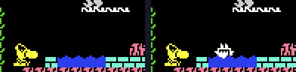
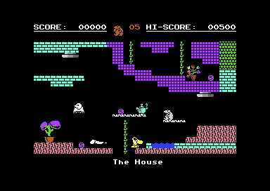
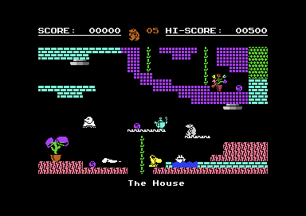

# Monty on the Run – Verification Notes

What was checked while writing this documentation, how, and where the source's comments, the README or earlier
assumptions turned out to be wrong. The source comments were not changed; the corrections below are for whoever next
edits the comments. One refactored-build bug found here has since been fixed; see [The Cheat Regression and Its
Fix](#the-cheat-regression-and-its-fix). "Measured" means observed in VICE 3.10 (`x64sc`, PAL) through `tools/launch.py`
and the monitor.

---

## Checked by Running the Game

| Claim                                 | Method                                                     | Result                                            |
| :------------------------------------ | :--------------------------------------------------------- | :------------------------------------------------ |
| Game interrupt rate                   | Cycle stopwatch between `MainGameLoop` entries             | 19,656 cycles: once per PAL frame                 |
| Attract interrupt rate                | The same on `AttractFrameUpdate`                           | ~10,150 / ~9,505: twice per frame                 |
| Start-up race window                  | `$0D52` (`CLI`) to `$330A` (`zp_attract_mode` set)         | 2,336 cycles, 11.9% of a frame                    |
| Race from the KERNAL idle line        | Start at line 300, as left by `-initbreak $E5CD`           | Jams every time (IRQ 644 cycles later)            |
| The refactored build fixes it         | Same start, refactored build                               | 3 of 3 reach the title (original: 0 of 3)         |
| Game over versus the jingle's `$FE`   | `GameOverAnimation` to `InitAttractScreen`                 | 12.4 s; the jingle ends at 13.3 s                 |
| Room data formats                     | `just docs-verify`: decoded rooms vs RAM dumps             | Match, except 205 cells drawn at run time (below) |
| Animated tile                         | Same: which of characters 1–8 differ                       | Only `room_metadata_tbl` bits 0–2 + 1             |
| Enemy sprite format                   | Decoder output against the screenshots                     | All 27 types render correctly                     |
| Cheat across `startGame`              | `just cheat-check` (below)                                 | Both keep it and show the cake (refactored fixed) |
| Both builds start                     | `just smoke`                                               | Both reach the title loop                         |
| The ending, with and without passport | `capture_screens.py --ending-only` (event 6 in room `$00`) | Boat sails; or arrest, score counts to zero       |

### What `docs-verify` Does Not Match

The decoder rebuilds each room from its data alone. VICE shows the room after 96 frames of play, in a capture run that
walks through every room in turn with the starting Freedom Kit. In that time the game has changed 205 cells in 16 rooms,
and each change has a cause in the code:

| Cause                                        | Rooms                             | Cells |
| :------------------------------------------- | :-------------------------------- | :---- |
| Piledrivers drawn into the playfield         | `$01 $02 $06 $0B $13 $19 $1B $28` | 129   |
| Teleporter pads                              | `$08 $14 $1C $2A`                 | 46    |
| The type-1 lift's column (character `$3C`)   | `$05`                             | 11    |
| Rope erased: no rope in the kit              | `$22`                             | 10    |
| Wall cleared: the run had collected the vase | `$14`                             | 4     |
| The three `$63` piledriver bases (event 4)   | `$1F`                             | 3     |
| The rising bollard                           | `$0C`                             | 1     |
| A coin Monty picked up during the 96 frames  | `$1F`                             | 1     |

The rope and the wall come from `ApplyItemRoomEffects`, which changes rooms according to the items collected and the
kit. The capture run also collected the room `$0D` cupcake, the vase and the joystick on the way (`si_collected_tbl` =
`$81`), which is why room `$1C` shows its floor without a gap.

---

## Corrections to Comments

| Where (byte-perfect)                        | The comment says                                           | The code does                                                                                         |
| :------------------------------------------ | :--------------------------------------------------------- | :---------------------------------------------------------------------------------------------------- |
| `InitialiseZeroPage`, `system_utils`        | Clears all 256 bytes, wrapping to `$00–$05`                | Clears `$06–$FF`; the loop ends when X wraps to 0                                                     |
| `InitializeInterrupts` (race note)          | Jams on ~20% of launches                                   | Window is 11.9% of a frame (≈1 in 8 at random); 100% from the KERNAL idle line                        |
| `teleporter_dest_tbl`                       | Fourth byte is a room                                      | It is the map row (`sta zp_map_row`): destinations `$06 $13 $1B $29`                                  |
| `ProcessTitleScreenControlKeys`             | `$86` is the CBM key                                       | `$86` is F1 (key matrix PA0/PB4); F1 toggles the sound                                                |
| `HiScoreNameInput`                          | `$8C` CRSR U/D confirms, `$8D` CRSR L/R deletes, `$8E` CBM | RETURN, INST/DEL and SPACE (`key_press_map` against the matrix)                                       |
| `hi_score_replacements`                     | 16 spaces rotate through entries 9–15                      | `zp_frame_toggle` is 0 or 1: entry 9 or 10 only. Trigger 20 can't match (19 is identical and earlier) |
| `cheatmode`, `ProcessHiScoreName`           | `$01` = cheat mode active                                  | `$01` only makes the cake appear; invincibility tests bit 7, set to `$81` by eating it                |
| `ProcessSprites`                            | Called twice per frame                                     | Once per frame, from the game or the attract interrupt                                                |
| `FreedomSequence`, `MontyEventDispatch`     | Event 6 is triggered by the jerry can                      | By touching the treasure (frame `$9B`); the jerry can only makes it appear                            |
| `CheckTileBelow`                            | Type-4 tiles trigger the piledriver-contact event          | Event 5, the hazard death (water/lava)                                                                |
| `CheckPiledriverContact`, at `$220A`        | Tile `$63` sets a speed limiter                            | Sets event 4, the piledriver death; only room `$1F` has `$63` tiles                                   |
| `InitPiledriverState`, `piledriver_contact` | Monty rides the room `$13` piledriver down                 | `UpdatePiledriverRide` decrements Y: the ride goes up                                                 |
| `enemy_tick` banner                         | `GetScreenRowAddress` at `$1454`                           | Entry is `$1455`                                                                                      |
| `hiscore_and_sprite_data`                   | Flying banner sprites, 3 × 4 frames                        | Packed enemy banks for types 32–34 (8 × 32 bytes each), unpacked like any enemy                       |
| `room_msg_idx_tbl`                          | Annotated to room `$30`                                    | Has entries to `$33`; rooms `$31–$33` show the C5 sector name                                         |
| Upstream `README.md`                        | "Sprite engine, multiplexer"                               | No multiplexing: 8 hardware sprites written once per frame (this README no longer says it)            |

---

## Things Not Described Before

- **The `$FE` stop command** calls `$8003`, running the CBM80 header bytes as code. Only song 1 uses `$FE`, and the game
  never reaches it (measured). A SID player does.
- **`$95A0–$95F9`** is an unlabelled KERNAL-interrupt music test harness plus a KERNAL reset routine.
- **Tile codes 9–15** are allowed by the map format but used by no room.
- **Bit 1 of the enemy flags** (`enemy_dir_flags_tbl`) is never tested.
- **The decoration blitter** over-copies 256 bytes when width × height × 8 is a multiple of 256. No decoration hits this
  (none has width × height divisible by 32).
- **`sfx_trigger_latch`** is read but never set to anything but 0 (the dead bytes at `$9589` set it).
- **`decor_init_flags`** (`$0327–$0426`) overlaps the start of the `$0400` scratch buffer; it is filled after the tile
  map has been copied out, so this is harmless.
- **`startGame`** clears zero page with interrupts on. It is safe only because a fire press is read in the attract
  interrupt, leaving ~150 raster lines before the next one. A debugger that jumps to `startGame` at an arbitrary moment
  can jam the CPU.

---

## The Late C5 Rooms

Rooms `$31`–`$33` are the last road screens before the boat: on map row 2 the road runs `$24`, `$25`, `$31`, `$32`,
`$33`, and room `$33`'s left exit leads to `$26`. Yet they are numbered after the ending room, `$30`. The code can't
date them, but everything in it fits rooms added late, to lengthen the road beyond `$24` and `$25`:

| Evidence                                                                                                 | Where                                          |
| :------------------------------------------------------------------------------------------------------- | :--------------------------------------------- |
| Numbered after the ending, although every other room is numbered roughly along the route                 | `room_exit_dest_tbl`                           |
| The C5 test is `$24`, `$25`, then "any room from `$31` up": a range that works only for the last numbers | `InitRoomDeathFlag`                            |
| The end of the road is coded on room `$33` (getting out, the jump to `$26`), not on `$25`                | `C5CheckEntryTrigger`, `C5CheckReturnTeleport` |
| The only three rooms that use two of their eight tile slots (the other six are `$00`, colour 0)          | `room_def_tbl`                                 |
| Built from decorations instead: 17, 14 and 19, three of the four highest counts in the game              | `decor_room_list`                              |
| Their tile maps and enemy records sit after room `$30`'s, in room order                                  | `room_tilemap_ptrs`, `room_enemy_ptrs`         |
| They share sector name 7, "Drive Sir Clive's C5", with `$24` and `$25`                                   | `room_msg_idx_tbl`                             |

The map cell that holds `$33` (`room_exit_dest_dyn`) is the only one written at run time: `startGame` sets it to `$33`,
and leaving the road sets it to `$FF`. The data order is weak evidence on its own, since every table is in room order.
The rest points the same way, but it is an inference from the code, not a record of how the game was written.

---

## The Cheat Regression and Its Fix

### What Was Wrong

In the original, the cheat flag (`cheatmode`) and the sound mode (`sound_mode`) live outside zero page at `$080E` and
`$080F`. `InitialiseZeroPage` clears zero page `$06–$FF` at two points: when the title screen is set up
(`InitAttractScreen`) and when a game starts (`startGame`). Neither variable is touched, so a flag set on the hi-score
table survives into the next game. That is how the cheat works: game over clears the flag, the name I WANT TO CHEAT sets
it to `$01`, and `startGame` leaves it alone. The cake then appears in room `$01`, and eating it sets `$81`
(invincible).

In Phase 2, the refactored build moved three variables into zero page, below the clear:

| Address | Variable        | Was                                                |
| :------ | :-------------- | :------------------------------------------------- |
| `$06`   | `sound_mode`    | `$080F`                                            |
| `$07`   | `sfx_sweep_dir` | a self-modified opcode in the SFX player (`$83B6`) |
| `$08`   | `cheat_mode`    | `$080E`                                            |

`InitialiseZeroPage` was changed from `LDX #$06` to `LDX #$08` to keep them. The source comments say the moved variables
are at "`$06–$07`". They were evidently written before `sfx_sweep_dir` was put at `$07`, which pushed `cheat_mode` up to
`$08`. As a result, the clear still started on `cheat_mode`:

```asm
InitialiseZeroPage:
  ldx #$08                            // first byte cleared: $08 = zp.cheat_mode
  lda #$00
!:
  sta $0,x
  inx
  bne !-
  rts
```

`startGame` wiped the flag, so the name cheat did nothing in the refactored build. Nothing failed: the game ran
normally, and only the cake never appeared. Neither `just smoke` nor the region guards could catch it.

### The Fix

The clear now starts at the byte after `cheat_mode`, computed from the zero-page layout instead of being typed in. A new
assembly-time guard fails the build if the layout is ever reordered so that `sound_mode` or `sfx_sweep_dir` lands above
`cheat_mode`, where the clear would wipe them:

```asm
.errorif zp.sound_mode > zp.cheat_mode || zp.sfx_sweep_dir > zp.cheat_mode, "InitialiseZeroPage would clear sound_mode or sfx_sweep_dir"
InitialiseZeroPage:
  ldx #zp.cheat_mode + 1              // first byte cleared: $09
```

The assembled program differs by one byte. The `LDX` operand at `$1DC2` (inside `Utils.InitialiseZeroPage`, `$1DC1`)
changes from `$08` to `$09`. Nothing else moves. The comments in `utils.asm`, `main.asm` (`StartUp`) and `zero_page.asm`
now give the real layout. The byte-perfect build is unchanged and still matches `reference.sha256`.

Two other bytes stay out of the clear as well:

- `sfx_sweep_dir` (`$07`) was already left alone before this fix. `InitSFXVoices` sets it before any read.
- `cheat_mode` (`$08`) is still cleared where the original clears `$080E`: at cold start (`StartUp`), at game over
  (`GameOverAnimation`) and by the RESET handler. The refactored build now treats it exactly as the original does.

### Before and After

`just cheat-check` (`tools/check_cheat.py`) reproduces the real sequence in VICE:

1. Set the flag to `$01` on the title, as the name entry does.
2. Start a game as a fire press would.
3. Read the flag at the first `LoadRoom`.
4. Send that room to `$01`.
5. After 96 frames, check that sprite 0 (the special item) is on with the cake's frame, `$BF`.

| Build                      | Flag after `startGame` | Room `$01` sprite 0 | Result |
| :------------------------- | :--------------------- | :------------------ | :----- |
| Byte-perfect               | `$01` (at `$080E`)     | on, frame `$BF`     | PASS   |
| Refactored, before (`$08`) | `$00` (at `$0008`)     | off, frame `$00`    | FAIL   |
| Refactored, after (`$09`)  | `$01` (at `$0008`)     | on, frame `$BF`     | PASS   |

Room `$01`, refactored build, with the cheat name entered. Before the fix (left), there is no cake. After the fix
(right), the cake sits on the water:



The full screens: before, then after.




These also passed after the fix:

- `just build-all`: the byte-perfect hash still matches, and the region guards hold.
- `just smoke`: both builds reach the title loop.
- The guard: moving `sound_mode` after `cheat_mode` in a scratch copy fails the build with the guard's message.

---

## Credits

The upstream `README.md` credits the game to Peter Harrap (creator) and Jason Perkins (C64 code). The game's own
hi-score table reads *written by Tony and Jason of Micro Projects for Gremlin Graphics, July 1985*, and the title
scroller calls it *a Gremlin Graphics and Micro Projects joint production*. This repository's README and this
documentation credit Peter Harrap (design), Jason Perkins and Anthony Clarke (C64 code), Rob Hubbard (music) and Gremlin
Graphics (publisher). [CREDITS.md](CREDITS.md) has the full credits, with the tools and links.

---

## Not Verified

- **The original image, by readers.** It isn't in this repository, so `reference.sha256` (`2f6975c0…4954389`) can't be
  re-checked here. It is the SHA-256 of the original game binary the source was disassembled from (`$080E–$FF72`, no
  load address); the owner confirmed it against that image on 02-11-2026, and both builds are checked against it.
- **Playing it through.** Rooms were reached by setting the room variables, not by playing; the ending, the arrest and
  the C5 sequence were read from the code, not watched.
- **Gameplay effects of the special items** come from the code and the source's catalogue (which says some were
  confirmed by the owner), not from play.
